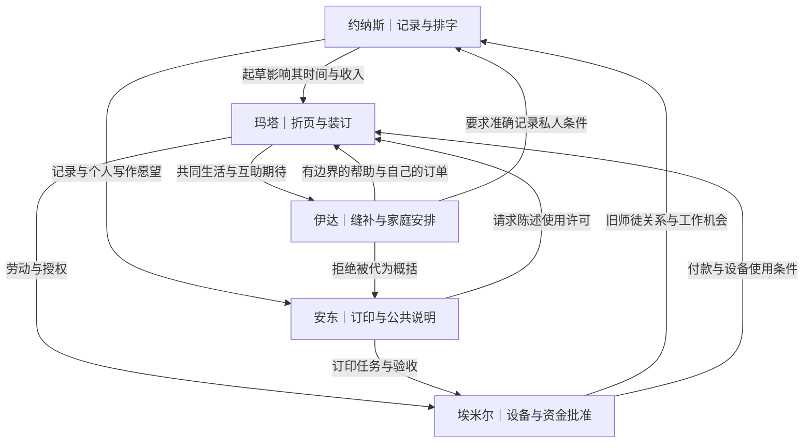
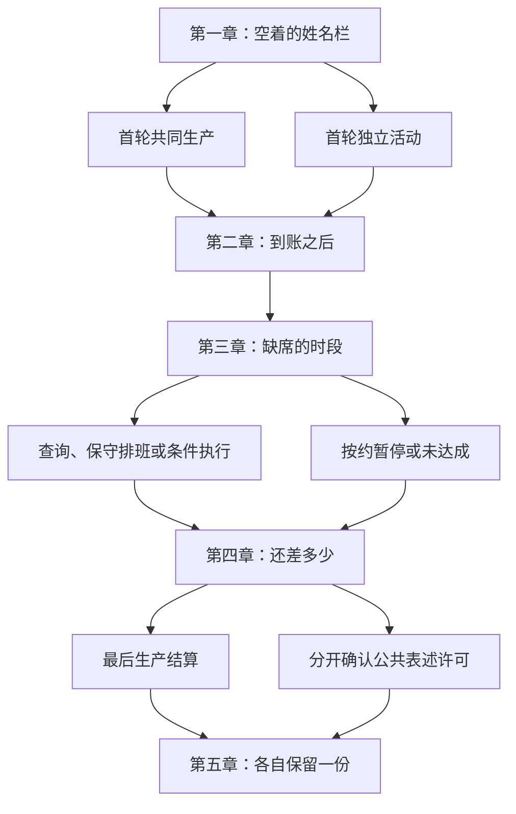
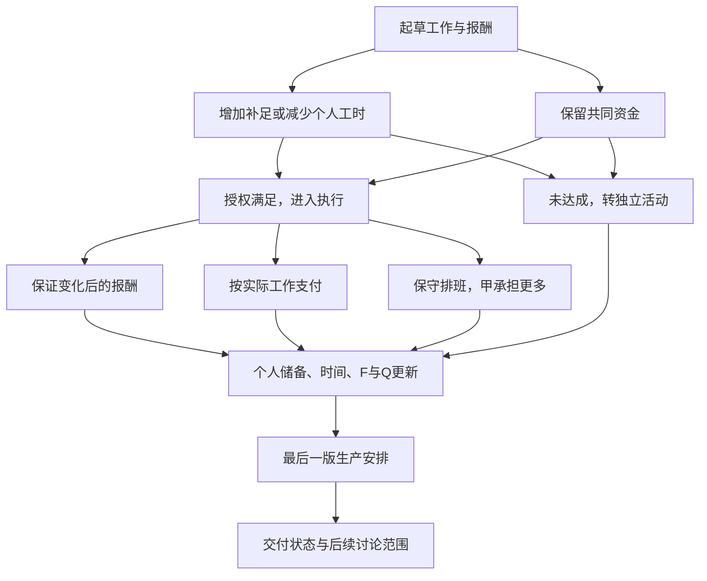
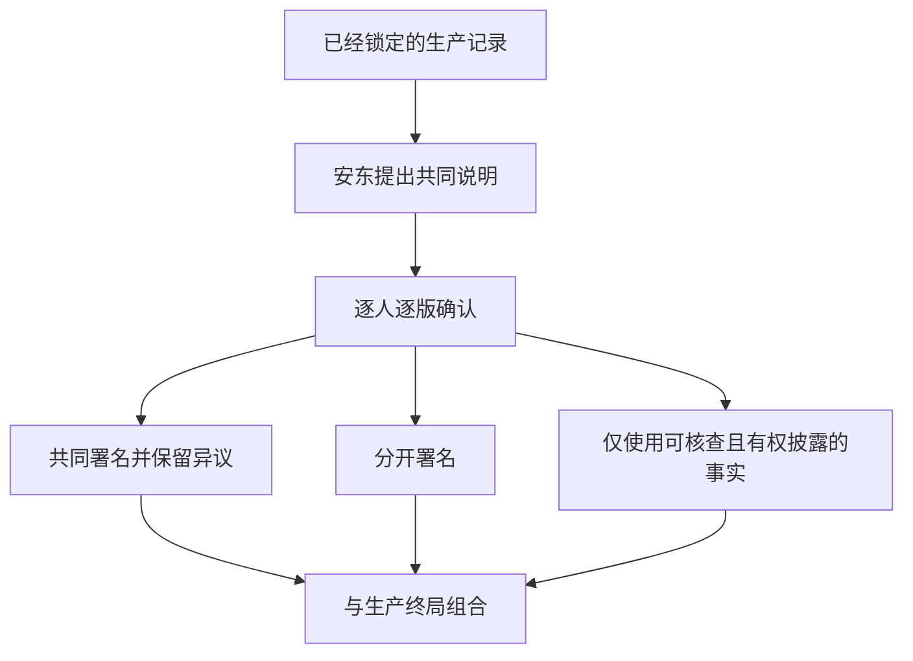

# 《共同署名》：阶段4叙事与角色结构

版本0.1｜2026-09-30｜范围：角色、视角、章节、终局与因果网络；非完整剧本。

依据：已读取阶段1《研究与创作材料地图》、阶段2《游戏核心概念设计》、阶段3《核心玩法与系统设计》的当前文档。

## 0. 叙事定位与继承边界

**故事核心：五个人围绕一批即将交付的阅读资料发生联系。他们可以为同一项工作签名，却不一定愿意被描述成抱有相同愿望的一群人。**

玩家的主要动作仍是起草、请求授权、执行和修订协议。戏剧冲突来自同一份安排在不同人的生活中产生不同后果；不以口头辩论替代系统。

阶段3尚未经过真人玩法验证。本轮按用户要求先建立可修订的叙事架构，不将完成本稿视为玩法已验证，也不改写前三份文件。若原型失败，可保留人物关系而缩减章节。

### 0.1 时空与史料身份

故事设于**1848年秋、一座未具名的德语区河港城市**，主要地点是一间临河印刷作坊及相邻生活空间。时间与空间属于历史启发的虚构设定，不对应一宗真实事件。本轮不主张这里的出版许可、劳动条件、女性职业机会或财产程序代表当时各地实际制度；具体地区参照仍待确定和核验。

主要任务是一批供不同读者阅读的资料，其中包含《共产党宣言》相关材料、其他意见及讨论留白。任务由一名联络人经手，委托范围与付款办法事先明确。故事不以“印出宣言便引发革命”为因果，不重演任何已知历史事件。

《宣言》通过**有来源标记的独立文本卡**进入体验；正文中关于劳动、财产、联合与代表性的观点可以被人物讨论，但人物概述始终标明“角色解释”。暂不写正式中文引文，避免尚未选定底本就制造伪引文。1848年人物不阅读1872年序言或20世纪解释；这些只允许在可选的当代阅读后记中出现。

### 0.2 四种不同的署名

| 署名类型 | 表示什么 | 不表示什么 |
|---|---|---|
| 生产协议签名 | 接受具体工作、收入与风险条件 | 赞同印刷内容 |
| 交付收据 | 确认数量、时间和款项 | 赞同对合作的政治解释 |
| 个人陈述许可 | 同意某段自己的陈述被怎样使用 | 允许联络人代表其他人 |
| 共同说明署名 | 明确接受这一版共同说明 | 对所有未来立场作无限授权 |

第四类不会取代第一类。共同说明必须逐人、逐版获得许可；任何人都可以选择只留个人说明，或者不公开私人理由。它只影响末章的归属与表述，不回写已履行的生产合同。

## 1. 故事发动机

临河作坊接下一批有明确期限的资料印制任务。三名直接参与生产的人原本都认为，条款写清楚便能避免互相为难。第一次结算之后，他们发现同样的报酬并不代表同样的生活余量，而同样的空闲也不代表已经有人承担了家里的工作。

第二个工作日，一项事先披露的外部安排改变了设备管理者能够亲自工作的时间。玩家此前写下的风险条款开始产生实际结果：有人获得保障，有人承担更多工作，或共同任务缩小。若变化很轻、玩家又准备充分，事情可以顺利完成；故事不强行制造违约。

第三个工作日，委托联络人希望在读者面前介绍这次合作。几个人这才发现，生产协议中的“我们”可能被用于另一种用途：描述他们共同相信什么。最终需要解决的并不只是还差多少交付，也包括谁可以总结这几天，以及谁有权保留不同说法。

高潮必须让玩家动手处理最后一版安排和陈述权限。结尾不靠演说替玩家解释“真正学到了什么”。

## 2. 五个主要人物

以下人名、经历和关系全部为游戏原创。职业、性别与财产经历作为角色提案，待选定地区后做历史可行性校核。

### P1 约纳斯·韦伯｜玩家所在位置｜对应阶段3甲

| 项目 | 设定 |
|---|---|
| 具体职业 | 按期受雇的排字工，兼校对和本次生产记录；没有资金支配权 |
| 经济处境 | 收入依赖接到工作，储备不多；能读写合同没有让他摆脱工资依赖。原型B=2、T=4、c=2 |
| 个人关系 | 埃米尔曾教过他技术；与玛塔长期搭班；安东赏识其文字能力；与伊达有过互换校字和修补衣物的帮助 |
| 个人欲望 | 完成一本由自己署名的小册，而不只是替别人校正文字；希望别人承认他的判断 |
| 恐惧 | 永远只是可替换的手；更怕自己的“整理”最后成为伤害别人的证据 |
| 短期目标 | 让首份安排可执行，按时拿到报酬，同时保留一点属于自己的时间 |
| 长期目标 | 获得稳定且允许独立写作的生活，不必每次用更多劳动换取被看见 |
| 内在矛盾 | 相信文字清楚能减少冲突，却享受自己作为起草者的权威；反感别人替他总结，也可能擅自替别人把话改得更“准确” |
| 难解问题 | 他既是协议记录者，也是受分配影响的劳动者；让自己多承担看似能解决问题，却可能使所有人依赖他的自我消耗 |
| 对社会的理解 | 认为权力一部分藏在能够规定、命名和记录事情的能力里；倾向于把程序改良视为可操作入口 |
| 盲点与误解 | 高估表达清晰的力量，低估现金不足和生活安排本身不可兼容；容易把未说出的需要理解为没有需要 |

**行为辨识：** 能快速发现条款主体不明，却可能迟迟不写下自己要保留的时间。玩家可以改变他的行动与优先次序；不能由旁白替玩家固定其最终立场。

**弧线范围：** 从“我要写出一份没有歧义的文本”，转向某种关于责任的实践：更严格的记录者、更积极的参与者，或承认自己不再愿意协调。不存在必须觉醒的唯一终点。

### P2 玛塔·克莱因｜折页与装订工｜对应阶段3乙

| 项目 | 设定 |
|---|---|
| 具体职业 | 按件承接折页、配页和装订工作的劳动者，不拥有主要印刷设备 |
| 经济处境 | 储备低，家庭必要开支高，需要稳定现金而非只看名义工价。原型B=1、T=3、c=3 |
| 个人关系 | 与妹妹伊达共同承担照护与生活事务；有一个未成为主要角色的孩子；信任约纳斯的手艺，对安东的代表性说法保持警惕 |
| 个人欲望 | 拥有固定、不必每次请求批准的半段自由时间；愿意画服装样式，却不想把所有兴趣都变成挣钱的工具 |
| 恐惧 | 自己生病或工作中断时没有缓冲；也怕每次要求付款都必须先展示家庭痛苦 |
| 短期目标 | 收入覆盖必要开支，并兑现对伊达的一次时间承诺 |
| 长期目标 | 不再完全依赖临时接活和亲属兜底，能自主安排生活 |
| 内在矛盾 | 支持彼此保障，但可能在急需收入时争取更多工作，使同伴或妹妹承担更多压力；理解公共诉求，却拒绝被当成展示苦难的例子 |
| 难解问题 | 较高收入与较少工作时间短期内未必兼得；没有一条好听条款能够替她完成所有生活义务 |
| 对社会的理解 | 用付款时间、被迫等待以及谁可以拒绝来判断一项安排是否可信 |
| 盲点与误解 | 可能低估专项现金与长期订单稳定的关系；容易把埃米尔的程序要求理解为对她个人的不信任 |

**行为辨识：** 她先问钱何时实际到手，再问工价。愿意解释授权条件，不愿反复公开私人细节。她的数值拒签条件仍按阶段3执行，人物背景不会偷偷新增好感门槛。

**弧线范围：** 可以继续合作、要求更清楚的保障、缩小投入或离开；离开不自动被写成短视，留下也不自动等于被说服。

### P3 埃米尔·霍夫曼｜印工及设备管理合伙人｜对应阶段3丙

| 项目 | 设定 |
|---|---|
| 具体职业 | 实际参与印制作业的印工，同时持有设备使用和本次专项资金的批准权限 |
| 经济处境 | 有生产资产控制权，但个人可支配现金不宽裕；工作资金不能当成家庭零用。原型B=2、T=4、c=2，F另列 |
| 个人关系 | 约纳斯的旧师傅；长期与玛塔合作；与安东有业务联系；认识伊达，但过去很少把她的时间当作生产条件 |
| 个人欲望 | 把作坊维持成一处自己仍能亲手工作的地方；不想只剩看账、求人和批准付款 |
| 恐惧 | 设备与名称仍在，自己却失去维持它们的能力；害怕共同资金没有人承担最后责任 |
| 短期目标 | 交付任务，处理一项旧合伙财产清点预约，避免一边工作一边许下不能兑现的承诺 |
| 长期目标 | 保住经营与手艺的连续性，形成不完全依赖自己在场的可靠安排 |
| 内在矛盾 | 希望别人共同承担责任，却不容易放下批准权；反对随意抽取现金，却可能支持一项同样保障自己收入的条款 |
| 难解问题 | 他的资产控制权和个人劳动紧密相连；愿意协商也不能保证账上凭空多出资金 |
| 对社会的理解 | 相信持续经营需要明确责任、可预测付款与对资产的维护；对单纯靠热情维持合作持怀疑态度 |
| 盲点与误解 | 容易把自己承担的责任看成更完整的责任，忽视别人承担了无法记入作坊账的风险；也可能把失去独断权限误读为失去全部尊严 |

**行为辨识：** 他反复区分“账上将收到”与“现在能支付”；不因此成为作者的经济常识代言人。当别人指出其许可权可以独立于其实际工作时，他必须回应。

**弧线范围：** 可以在原有权限下继续、更清楚地说明授权、愿意讨论新规则，或停止本次合作。故事不以他是否交出设备判断其道德价值。

**时间事件的透明性：** 第二轮财产清点预约可能使其可用时间为1或3，范围开局公开。此事件不改变设备所有权、不新增债务扣款、不必然导致违约。第三轮恢复基准时间也预先告知。查询可以核实返回安排，不要求揭露其全部私人经历。

### P4 伊达·克莱因｜缝补工｜家庭关系与未计入协议的行动者

| 项目 | 设定 |
|---|---|
| 具体职业 | 接零散缝补和改衣订单，有自己的工作日程 |
| 经济处境 | 收入不稳定，家庭互助减轻开支也挤占其接单机会；她的钱不是玛塔B的隐藏补充 |
| 个人关系 | 玛塔的妹妹，与其互相帮忙照顾家庭；通过小型互换帮助认识约纳斯；对安东过去遗漏个人条件的写法有戒心 |
| 个人欲望 | 让自己的订单第一次成为家里不用优先让路的安排；希望独自保留一段下午时间 |
| 恐惧 | 因为能帮忙，就被永久认定为随时有空；拒绝一次便被理解为不爱家人 |
| 短期目标 | 完成已接的缝补任务，不再自动接下新增照护 |
| 长期目标 | 建立可预期的生活安排，能够决定与姐姐同住还是另作打算 |
| 内在矛盾 | 真心愿意帮姐姐，也会因自己的帮助未被看见而积累怨气；可能在愤怒中低估姐姐的工作压力 |
| 难解问题 | 家庭互助既提供安全，也使界限难以表达；单靠作坊内的公平付款不能解决所有照护安排 |
| 对社会的理解 | 判断一项改善时，先追问多出来或被拿走的时间最后落在谁身上 |
| 盲点与误解 | 未必了解作坊不能随时把回款提前支付；也可能把约纳斯的无知理解为有意忽略 |

**行为辨识：** 她可以明确说明自己何时不在，也可以不愿让私人说明进入公共材料。她不是等待玩家分配的免费照护资源。

**系统边界：** 本轮不新增伊达的经济模拟。玛塔T=3已经扣除固定生活义务；伊达不会在章末突然夺走系统已经承诺的时间。玛塔获得至少1时段未安排时间时，可以用短场景兑现已提出的家庭协商；没有余量时，伊达照常完成自己的订单，而不是被脚本强迫救场。

**弧线范围：** 形成新的边界、保留亲密同时减少兜底，或暂时维持互助。她的价值不以是否支持作坊合作来衡量。

### P5 安东·罗特｜账册抄写员兼阅读小组联络人｜委托与公共解释

| 项目 | 设定 |
|---|---|
| 具体职业 | 以抄写账册谋生，兼任一个阅读小组的订印与收件联络人 |
| 经济处境 | 个人收入有限；受托经手的订印款不是自己的资产，也不能随口追加。他对付款和验收有明确而有限的权限 |
| 个人关系 | 欣赏约纳斯的文字；需要埃米尔的作坊按约交付；想请玛塔提供生活经验；与伊达因“谁能代表谁”存在摩擦 |
| 个人欲望 | 让读者认真对待来自劳动生活的声音，也希望自己成为能把分散的人联系起来的人 |
| 恐惧 | 事情停留在零散抱怨，没有任何持续行动；也怕承认分歧后，自己的联络工作显得无用 |
| 短期目标 | 收到约定资料，向读者提供一份能够理解的合作说明 |
| 长期目标 | 维持一个可以讨论、互助又能采取具体行动的公共空间 |
| 内在矛盾 | 重视共同声音，却容易为了简洁删去不一致的条件；反对别人垄断话语，却可能认为自己更懂怎样让读者听见 |
| 难解问题 | 清楚、可传播的叙述常需要压缩，而压缩可能改变被代表者的意思；他没有能力兑现所有公共期待 |
| 对社会的理解 | 认为分散经验需要组织和共同语言才更容易产生持续影响；《宣言》对他是重要但非不容质疑的参照 |
| 盲点与误解 | 容易把不愿公开等同于不愿合作，把共同完成工作等同于共享政治目标；低估暴露私人处境的成本 |

**行为辨识：** 会主动带来不同材料和读者问题，也会提出一句过于整齐的总结。玩家可以要求他限定范围；他能改稿、保留不同陈述或放弃共同说明，而非必然恶意伪造。

**系统边界：** 已验收产出的回款仍严格按阶段3结算。拒绝公共署名不会使他报复性扣款。原型单位产出与回款是预算抽象；不能把真实排字、印刷和装订工序都解释为相同劳动效率。

## 3. 角色关系图

这些边不是好感线。师徒关系不带来无条件服从，家庭关系不带来无限劳动，委托关系不带来思想授权。

## 4. 多视角如何进入同一套玩法

玩家始终以约纳斯的权限编辑协议。多视角通过收到的便条、获准查看的账目、他人的陈述和执行后的具体行动呈现；不新增五人轮流控制，也不在关键选择前展示全知内心独白。

下列表格是作者用的知识表，不是全部直接展示给玩家的界面。人物的未知必须与信息来源对应。系统已经公开的容量、资金和授权条件不能因为需要悬念而重新藏起来。

### 事件E1：第一份“平均安排”被拒绝

测试用草案是每人工作2、支付2。玛塔的期末储备会变成0，低于她公开的参与条件。若玩家一开始就提出可接受方案，不强制发生拒签，而改为记录她为何能够接受。以下表格描述拒签分支。

| 人物 | 知道什么 | 不知道什么 | 认为发生了什么 | 希望发生什么 | 实际做什么 |
|---|---|---|---|---|---|
| 约纳斯 | 工时与金额相同，玛塔的公开预算不满足边界 | 玛塔为何特别在意当天某段时间 | 形式平等未产生相同余量，也可能先误以为只需解释 | 不追加工作也能得到可签方案 | 检查差异，提出补足、重分工或缩小任务；由玩家决定 |
| 玛塔 | 自己付款后的余量，伊达已有安排 | 埃米尔具体担心哪一笔下一期现金 | 自己再次需要为并不特殊的生活支出作解释 | 收入可用，不用公开家庭全部细节 | 拒签该版，明确最低可接受条件；不无限延展理由 |
| 埃米尔 | F的预付限制和设备使用安排 | 玛塔家中具体如何交换时间 | 若每项需要都变成额外支付，下一轮可能缺现金 | 方案留出周转空间 | 指出支出上限，批准或拒绝具体合法方案；不宣讲利润最大化 |
| 伊达 | 自己的缝补订单和曾与姐姐商量的时间 | 当前草案精确数字，除非玛塔愿意告知 | 作坊正在把两人的家庭安排当成可调整背景 | 自己的安排被承认为已经存在 | 给出自己的可用边界；不自动答应额外照护 |
| 安东 | 交付范围与支付约定，尚未签署 | 每个人的储备及家庭细节 | 初稿还没能把共同工作组织起来 | 尽快有一个可执行安排 | 确认验收规则不会因谁拒签而改变，不追加虚假奖励 |

### 事件E2：埃米尔的实际可用时间少于计划

开局已说明第二轮可能只有1或3时段。严重分支为1；较轻分支为3。以下描述严重分支，不能据此让较轻分支也出现不存在的损失。

| 人物 | 知道什么 | 不知道什么 | 认为发生了什么 | 希望发生什么 | 实际做什么 |
|---|---|---|---|---|---|
| 约纳斯 | 写下了怎样的风险条款，查询与否的成本 | 未查询时的实际返回安排 | 若已保障则是共同承担风险；若未保障则是边界内的收入变化 | 承诺兑现，又不耗尽自己的时间 | 按已授权条款执行；结算后提修订，不能临时改旧账 |
| 玛塔 | 自己的收入、工时与剩余资金 | 埃米尔的全部私人经历 | 可能看到保障开始适用于别人，也可能发现自己以后同样缺少保障 | 不因他人缺席被无偿加派工作 | 只履行已同意的时段；任何新增工作必须重新授权 |
| 埃米尔 | 外部预约的缘由、当前可用时间 | 别人会怎样理解其缺席 | 自己批准的规则现在也约束自己 | 既不让作坊失去连续性，也不被要求自动放弃已约定收入 | 履行可用时段；接受合同允许的结算，不单方面重写 |
| 伊达 | 姐姐有没有把剩余时间用于已约定的生活安排 | 丙的报酬是否保证，除非当事人告知 | 可能认为所有“临时”变化最终都要求家庭兜底 | 本期边界不会被无声突破 | 继续自己的订单；对新请求分别回应，不触发隐藏扣时 |
| 安东 | 实际交付量和此前约定的收件范围 | 未获许可的个人预算和私人缘由 | 是一次已知风险的具体结果，不等于所有人违约 | 获取准确交付说明 | 按实际接收付款；提出问题但不把拒绝公开解释当扣款理由 |

### 事件E3：安东提出用共同名义介绍合作

此事件一定发生，但同意、限定或拒绝均有效。请求只针对未来的公共说明，不修改已经印出的历史文本或已经结算的收据。

| 人物 | 知道什么 | 不知道什么 | 认为发生了什么 | 希望发生什么 | 实际做什么 |
|---|---|---|---|---|---|
| 约纳斯 | 合同与履约记录；哪些话属于自己 | 别人是否接受同一总结 | 记录者身份正被变成代表者身份 | 保留自己的判断，又不替别人作决定 | 将共同事实、个人解释和待授权表述分开，提出可确认版本 |
| 玛塔 | 自己接受了劳动条件，不等于同意全部观点 | 读者会不会把她当成一种固定类型 | 付出可能被转化为他人的论据 | 不必否认合作，也能拒绝被代言 | 选择共同署名、只认个人段落或不公开；不给政治分数 |
| 埃米尔 | 自己的权限和实际支出记录 | 读者是否把他的全部行为归因于资产身份 | 担心复杂责任被压成某种典型 | 说明自己承担过什么，也接受可核查的批评 | 对涉及自己的事实核对；不能要求删掉真实且有权披露的支出 |
| 伊达 | 自己从未签署生产协议，也未同意被纳入叙述 | 外部读者会怎样理解家庭关系 | 一个没有列入生产名单的人可能仍被用于证明合作成功 | 自己的安排和沉默都被尊重 | 拒绝、限定或提供个人说明；拒绝不影响别人合法发言 |
| 安东 | 读者需要简明说明，生产记录可以支持部分事实 | 哪些措辞超出了当事人许可 | 原以为共同劳动能形成共同故事，现在发现授权有边界 | 仍能建立联系，又不丧失可读性 | 接受逐段许可，修改总结，或只报告公开事实；不自动伪造签名 |

## 5. 五章完整结构：一个任务、三个结算周期

总体验目标约65—90分钟。五章是戏剧与信息结构，**只有第1、第3、第4章各结算一个生产周期**。第2和第5章不额外扣生活支出，不因文本多读几页消耗时间。三个周期仍继承阶段3的Q=24与d=3；不把五章误做五次经济扣款。

### 第一章《空着的姓名栏》｜提出共同任务，发现第一道边界

- **时间：** 第一工作日，任务开始至首轮结算前后；约12—16分钟。
- **地点：** 作坊前室与工作台，以同一主界面的不同文件表现。
- **主要角色：** 约纳斯、玛塔、埃米尔；安东提交委托；伊达通过已知家庭安排进入。
- **核心冲突：** 大家同意需要工作，却没有天然一致的时间、报酬与风险条件。
- **系统状态：** B=(2,1,2)、T=(4,3,4)、c=(2,3,2)、F=9、Q=24、d=3；第二轮容量变化范围提前提示。
- **玩家行为：** 核对委托；起草首份分工与报酬；请求签署；执行或明确不达成。
- **重要选择：** 补足玛塔、重新安排工时、缩小首轮任务，或允许部分人不加入。不得为了教程强制先写一份错误方案。
- **视觉变化：** 空白姓名栏逐步出现独立的授权状态；金额字段显示用途和控制者。
- **文本结构变化：** 从一份委托，分成工作、收入、条件、签名四部分；“任务”与“如何完成”首次分离。
- **进入下一章：** 将第一轮实际结果带入；若没有共同工作，则带入独立收入与未交付记录，仍进入第二章。
- **戏剧功能：** 激励事件与第一次不可逆承诺。不是介绍概念的讲课章。

### 第二章《到账之后》｜同一个结果进入不同生活

- **时间：** 第一工作日结算后的傍晚；约10—14分钟；不再推进经济轮次。
- **地点：** 作坊账桌、相邻居所门口与伊达的缝补桌，以收到的材料切换，不新增漫游地图。
- **主要角色：** 约纳斯、玛塔、伊达；埃米尔的账目；安东的收件确认。
- **核心冲突：** 作坊账上“已支付”与个人生活中的“已经足够”并非同一件事；未安排时间也没有默认主人。
- **系统状态：** 只读上一轮B、F、Q、个人未安排时间与U，d=2。缺口是否出现由实际结算决定，不能强写饥饿或感激。
- **玩家行为：** 对照收据、预算与时间记录；请求而非强制披露私人缘由；记录下一轮需要重新确认的事项。
- **重要选择：** 如何使用约纳斯自己的空闲；是否接受别人拒绝解释；是否将一项尚未确认的愿望写成明确“请求”而非“已承诺”。
- **视觉变化：** 同一金额出现在作坊账与个人预算的不同位置；空白时段展开已有生活用途，而不是突然新增惩罚。
- **文本结构变化：** 主协议保持封存，人物批注分开显示，不自动并成一个共同评价。
- **进入下一章：** 数值不重置；只增加已获准的信息K和下轮待讨论事项。埃米尔再次确认第二轮可能时间范围。
- **戏剧功能：** 第一轮行动的余波，建立私人愿望与共同目标的距离。

### 第三章《缺席的时段》｜原先写下的条件真正生效

- **时间：** 第二工作日；约17—22分钟。
- **地点：** 作坊协议页与外部预约回执；外部地点不开放新场景。
- **主要角色：** 约纳斯、埃米尔、玛塔；伊达与安东分别提供家庭和交付视角。
- **核心冲突：** 已知风险变成现实后，谁的收入、时间或共同资金承受变化？
- **系统状态：** 继承B、F、Q；d=2；丙T∈{1,3}，真实分支预先固定；查询消耗甲1时段。
- **玩家行为：** 决定是否核实；设定保证／按实际／暂停条件；取得新版本授权并结算第二轮。
- **重要选择：** 保障埃米尔收入、由约纳斯多做、按实际支付、缩小任务或不达成。不得在事件发生后免费改旧协议。
- **视觉变化：** 计划列与实际列并排，未完成时段以明确差异出现；签名仍保留，避免把条件变化画成背叛。
- **文本结构变化：** “如果”条款变成已执行记录；每笔差异可追溯到此前选择。
- **进入下一章：** 带入第二轮真实结果及Q缺口。第三轮丙恢复基准容量，不能为制造高潮继续追加不明事故。
- **戏剧功能：** 中段检验。若准备充分、条件较轻，冲突转为“保障为何暂未用上、是否仍值得保留”，不强迫一场灾难。

### 第四章《还差多少》｜最后一次生产决定与共同叙述的分歧

- **时间：** 第三工作日，最后一个生产周期；约17—22分钟。
- **地点：** 作坊工作台与待确认的公共说明提纲。
- **主要角色：** 五人都进入视野，只有甲乙丙进入生产结算。
- **核心冲突：** 最后的资金与时间如何使用；同时，安东希望用一个简明“我们”描述这几天，当事人开始要求区分授权。
- **系统状态：** d=1，丙T=4；F与Q完全继承，不赠送临时资金。公共陈述许可是独立元数据，不影响现金或生产效率。
- **玩家行为：** 对照最后可行方案；完成生产授权与结算；标明公共说明中哪些是可核查事实、哪些是个人判断、哪些尚未获得许可。
- **重要选择：** 追求剩余交付、保护时间或收入、缩小参与范围、结束本次生产；对公共说明可以限定、保留分歧或拒绝共同署名。
- **视觉变化：** 生产协议的姓名栏与公共说明的姓名栏明确分离；一个勾选不会复制到另一栏。
- **文本结构变化：** 从单一总结提纲分化为共同事实、个人陈述、保留意见；已经印出的正文和既有协议不可被回写。
- **进入下一章：** 第三轮结果锁定，d=0；Q是否为0决定交付状态，公共许可是否齐备决定可用署名范围。
- **戏剧功能：** 行动高潮。玩家不能用漂亮声明补上未完成产出，也不能因产出完成而自动取得所有人的认同。

### 第五章《各自保留一份》｜交付、陈述与下一次是否再见

- **时间：** 第三工作日结算后至简短后记；约9—16分钟；不新增经济轮次。
- **地点：** 作坊交付桌；各人收到的记录副本。
- **主要角色：** 全体五人，每人有独立且与实际状态一致的收束。
- **核心冲突：** 谁能总结这次合作；是否愿意再次讨论，不等于现在已有下一份有效合同。
- **系统状态：** B、F、Q、U与L只读；公共表述许可可在最终确认前撤回，已发生交易不因此变化。
- **玩家行为：** 核对收据；分别确认生产事实和个人陈述归属；决定约纳斯是否愿意收到下一份提案；查看他人明确反馈。
- **重要选择：** 共同说明、并列个人说明或只留事实；下一次共同讨论、较小范围联系或不再预约。不能伪造未同意者的签名。
- **视觉变化：** 统一页面可以保持一份附有异议的文本，也可以分成不同副本；分开不采用破碎、灰暗等默认失败编码。
- **文本结构变化：** 主张与事实都有归属；沉默留下明确空位，不由旁白代写内心。
- **后续与终局：** 根据实际交付和明确的后续联系范围组合终局。未来合作只有意向，没有免费新增收入、产权变化或确保成功的承诺。
- **戏剧功能：** 后果与余韵。人物愿望可以仍未完成，玩家也不必选出一段总结性政治结论。

## 6. 章节结构图

分支汇合的是时间与场景，不是资源和人物态度。进入同一章时，章节读取各自真实的账目、缺口、参与记录与许可，不把分支抹平。

## 7. 关键事件时间线

| 时间 | 事件 | 固定／条件 | 人物最早何时知道 | 玩家能影响什么 | 保留到后续的记录 |
|---|---|---|---|---|---|
| 开始前 | 一项印制任务已约定验收规则，周转资金已划入专项账户 | 固定前提 | 第一章开场可见 | 是否以及怎样组织本次生产 | 委托、F与Q，不能擅自挪用 |
| 第一日开始 | 埃米尔披露次日时间可能缩短 | 固定 | 第一章签署前 | 如何预先考虑未来资金和分工 | 时间范围与来源 |
| 第一日首稿 | 出现平均分配但玛塔不可接受的可能 | 条件事件E1 | 预览立刻说明 | 改分工、补足、减量、部分合作 | 草案差异与有效签名 |
| 第一日结算 | 收入与时间进入不同生活 | 必然有结果，内容条件化 | 实际结算时 | 后续安排；不能倒改旧结算 | B、F、Q、未安排时间、U |
| 第一日晚 | 伊达明确自己的订单边界 | 固定表达，回应依结果变化 | 第二章 | 是否准确记录、是否承认未获授权 | 私人请求与许可，不新增隐藏扣时 |
| 第二日签署前 | 可核实埃米尔可用时间 | 玩家可选 | 查询后；否则只知范围 | 用1时段换确定信息 | K与k |
| 第二日执行 | 时间分支落实，风险条款执行 | 外部值固定，损益依方案 | 查询或执行时 | 已授权分支；不能临时转嫁工作 | 实际h、w、Y与差异原因 |
| 第三日开始 | 安东请求共同说明 | 固定请求，无固定答案 | 第四章 | 说明范围、个人陈述、共同署名 | 独立的表述许可 |
| 第三日结算 | 最后一期生产结束 | 固定时点，结果可变 | 结算时 | 最后一次合法安排 | 完成／部分／无共同交付 |
| 第三日结束 | 各人核对记录与后续联系意向 | 固定程序，回应可变 | 第五章 | 自己的许可和意向，不控制他人 | 终局主状态与个人副本 |

没有“必定背叛”“必定起义”或“必定贫困”的预定节点。失约、生活缺口与保障收益只在相应条件实际发生时叙述。

## 8. 终局：生产结果与合作去向组合

### 8.1 判定方法

先记录交付状态：全部完成Q=0、部分完成0<Q<24、没有共同交付Q=24。

再记录甲乙丙是否明确愿意参与下一次讨论，形成集合C。这里是接收与讨论新提案的意向，不是下一轮工作授权。安东和伊达分别记录联系与陈述许可，不混入生产人数。

终局不使用隐藏好感或最后一句政治选择。人物后续意向须用可见的具体条件表达。为避免新增巨大模型，初版建议：

- 约纳斯由玩家决定是否愿意继续讨论。
- 玛塔在期末B≥1时愿意收到满足其收入和时间边界的新方案；B<1时先选择找确定收入，暂不约下一轮。文案不能说她反对所有合作。
- 埃米尔在F>0且个人B≥1时愿意讨论下一份方案；若不满足，先暂停接约并核对资源。F>0不证明下一单能开工，下一单仍需独立预算和签署。
- 所有人对共同说明的同意与否，都不影响上述资金或意向条件。

这是为写作和实现对齐提出的**终局元数据扩展**，尚非经过测试的人物行为模型。若其反馈显得机械，应修改具体边界与表达，不能悄悄加入心情分。

按顺序判定：Q=24优先进入E6；否则C为三人进入E1或E2；C为两人进入E3；C为零或一人进入E4或E5。这样主终局互斥且覆盖所有状态。少于两人的意向不称为共同续约；旧任务记录仍保留。

### 8.2 六个主终局

| 终局 | 条件 | 解决了什么 | 留下什么 | 如何体现此前选择 | 可以怎样理解 |
|---|---|---|---|---|---|
| E1《下一稿仍在桌上》 | Q=0，C三人 | 完成交付，三人愿意继续讨论 | 收入与时间可能仍不均，批准权未自动改变 | 合法分配、承受风险与保留资源共同形成结果 | 是可持续合作的起点，也可能只是成功维持旧关系 |
| E2《留下一页》 | 部分交付，C三人 | 保住再次讨论的空间，确认已完成部分 | 未完成任务明确留下，下一次资金仍须解决 | 减量、保障或暂停留下可追溯差额 | 可以是有边界的合作，也可以是仍未解决的能力不足 |
| E3《两份地址》 | 有交付，C两人 | 部分人保留联系，另一人可以退出 | 合作范围缩小，退出者生活不自动改善；两人不一定拥有下一任务全部资源 | 参与、补足与最后资源影响退出条件 | 可以是尊重差异，也可能暴露原安排容不下某种处境 |
| E4《结清之后》 | Q=0，C至多一人 | 工作与已授权支付完成 | 没有足够人愿意立刻再约，经验未必形成组织 | 完成交付的代价可能落在时间或个人边界上 | 可以是完成一项有限合作，也可以是关系被耗尽 |
| E5《到这里为止》 | 部分交付，C至多一人 | 停止追加当前无法承担的义务，保留真实记录 | 未完成部分与生活问题都未被解决 | 资源、时间和拒签边界共同导致停止 | 可以是必要止损，也可以是一次没有持续下去的尝试 |
| E6《没有共同出品》 | Q=24 | 未经授权的共同劳动没有发生，个人仍保有各自行动 | 没有共同交付，独立谋生可能带来生活缺口 | 三期未达成、暂停或无实际产出的组合 | 可以是保护边界，也可以是失去了一次机会；继续讨论意向另行保留 |

任何终局都不让安东拒付已经验收的产出，不因拒绝共同署名追加惩罚。Q>0就是有未完成任务，不能用诗意旁白抹掉；Q=0也不掩盖个人缺口和被耗尽的时间。

### 8.3 每个终局中的五条人物后记轴

后记不预写固定人生结局，只根据已经发生和已经授权的事项组成短段落。

| 人物 | 后记依据 | 可出现的变化 | 禁止擅自宣告 |
|---|---|---|---|
| 约纳斯 | 累计工作／协调时间、保留时间、自己的意向 | 继续记录、限定协调责任、保留个人写作时间或离开本次协调 | 因一次选择永久成为某政治立场代表 |
| 玛塔 | B、U、未安排时间、参与记录 | 本期有余量、仍需确定收入、兑现了一次时间安排或没有条件兑现 | 储备稍高就从此脱离不稳定劳动 |
| 埃米尔 | B、F、许可与履约记录 | 愿意再讨论、暂不接约、承认哪些责任仍未解决 | 愿意听取意见就已改变所有权制度 |
| 伊达 | 玛塔是否实际有时间、其自身许可 | 完成自己的订单，保留边界，互助安排有变化或仍待商量 | 她必然原谅或必须继续无偿照护 |
| 安东 | 实际交付、获准表述范围 | 形成共同说明、并列陈述或只报告事实 | 没有统一口号就宣告公众无法理解或行动 |

另附三种可组合的表述结果：**共同署名且保留异议／不同署名并列／只有可核查事实**。它们可以出现在任何主终局中，不分高下。原始文献的作者和来源始终独立，不与人物署名合并。

## 9. 玩家选择与后果网络

图中的边表示可能路径，是否满足授权由实际参数决定，不能理解为任意选择都必定获得签名。

第二个网络没有回到资金结算的边。言论许可不能成为扣薪条件，拒绝被代表也不能被当作撤销已履行劳动。

### 9.1 选择与可写内容的对应

| 玩家行为 | 即时后果 | 延迟后果 | 可出现的叙事反应 | 不能强写的反应 |
|---|---|---|---|---|
| 给玛塔补足 | 个人余量或可用时间改善，F减少 | 下一期预付范围可能缩小 | 她确认具体改善，伊达看见是否有实际时间 | 玛塔因此认同玩家全部观点 |
| 保证埃米尔报酬 | 短工时分支仍支付原约金额 | F可能下降，丙储备增加 | 丙面对自己同样需要保障这一事实 | 他必定感动并交出批准权 |
| 约纳斯承担更多 | 工作和收入增加，空闲减少 | 个人写作或休息未获时间 | 别人可以感谢，也可以担心这种安排难以持续 | 全体因此自动团结 |
| 花时间查询 | 信息更清楚，甲可生产时间减少 | 更准确安排与机会成本共同存在 | 未发生损失时仍显示查询的价值边界 | 查询必定揭穿某个坏人 |
| 允许玛塔不参加 | 不安排其劳动和共同报酬 | 独立生活结果与生产任务分开 | 她不再解释这期工作选择，仍可保留联系 | 她必定背叛或被惩罚 |
| 拒绝共同说明 | 共同署名范围减少 | 采用个人说明或公开事实 | 安东需修改概括，关系可以保留分歧 | 已交付报酬被扣，或人物突然敌对 |

## 10. 《宣言》在叙事中的具体位置

| 进入位置 | 材料与作用 | 玩家必须做什么 | 防止说教的方法 |
|---|---|---|---|
| 第一章委托材料 | 独立来源卡说明资料包涉及《宣言》及不同意见 | 只需识别生产任务与文本来源，不须读完 | 接单不等于接受立场，阅读不是过关条件 |
| 第二章结算旁 | 可选链接把个人经历与劳动、财产关系的文本主张并置 | 可以选择阅读，也可直接继续 | 卡片标明“文本主张”，不宣布系统已经证明它 |
| 第三章修订旁 | 人物对保障、责任与共同利益提出不同解释 | 处理实际条款，而非选理论答案 | 相同事实允许不同判断；事实本身可核查 |
| 第四章公共说明 | 安东关于共同与长远利益的解释，与个人授权冲突 | 区分哪些话是他的解释、哪些由他人同意 | 既不把代表性主张天然正确，也不把组织努力天然可疑 |
| 第五章可选当代后记 | 回到原文及其局限，列出待研究的历史问题 | 可继续阅读，不影响终局等级 | 后来的序言与接受史明确置于1848年人物知识之外 |

不将游戏原创协议写成马克思、恩格斯设计的制度蓝图。家庭时间和授权程序来自本项目的创作建模，不能冒称原文逐条提供。

## 11. 实现与一致性清单

### 11.1 必须继承的系统约束

- 三人生产参数和三轮结算保持阶段3基线；五个主要人物不等于五人都进入经济模拟。
- 两个观察与收束章节不消耗额外生活支出。
- 埃米尔第二轮缺席不等于撤回设备许可；许可在签署时明确，其他人仍可按已授权安排工作。
- 印制作业的复杂工序暂由任务单位抽象，不新增隐藏技能瓶颈；真实行业流程需后续校核。
- 共同说明发生在生产记录之外，不要求免费改印已完成文本，不增加未建模的“重印成本”。它是安东之后向读者说明的授权范围。
- 场景读取真实状态；无缺口时不写挨饿，有保障时不写被取消报酬，没有签名时不写共同同意。

### 11.2 本轮提出的少量叙事元数据

| 数据 | 用途 | 是否改变生产数值 |
|---|---|---|
| 各人陈述版本与公开许可 | 共同／个人／不公开的归属 | 否 |
| 后续讨论意向集合C | 区分终局联系范围 | 否；不等于新合同 |
| 已展示的视角材料 | 避免重复、保持知识来源 | 否；查询成本仍按阶段3 |
| 私人请求是否被准确记录 | 对话与个人副本的一致性 | 否；不增加隐藏好感 |

如果未来要让“帮助伊达”直接改变玛塔T，或者新增自愿出资、所有权变更和信用系统，必须回到阶段3修改规则与测试，不能在剧情里偷偷实现。

### 11.3 内容规模控制

建议每章1个核心协议节点或对照节点，辅以每个相关人物最多1—2份短材料。正文不建立每次点击都分叉的树；采用固定章节、状态条件化片段、少量独立后记组合。

制作优先顺序：先确认人物边界与系统不冲突；再写三件共享事件的差异视角；再写五章连接；最后填充个人语气。不要先写长独白，再强迫系统为独白制造结果。

本稿包含角色关系图、章节结构图、关键事件时间线以及两层选择后果网络。它们共同约束后续剧本：事实由记录决定，人物解释有归属，玩家改变行动与授权，结尾保留真实的未解决问题。
