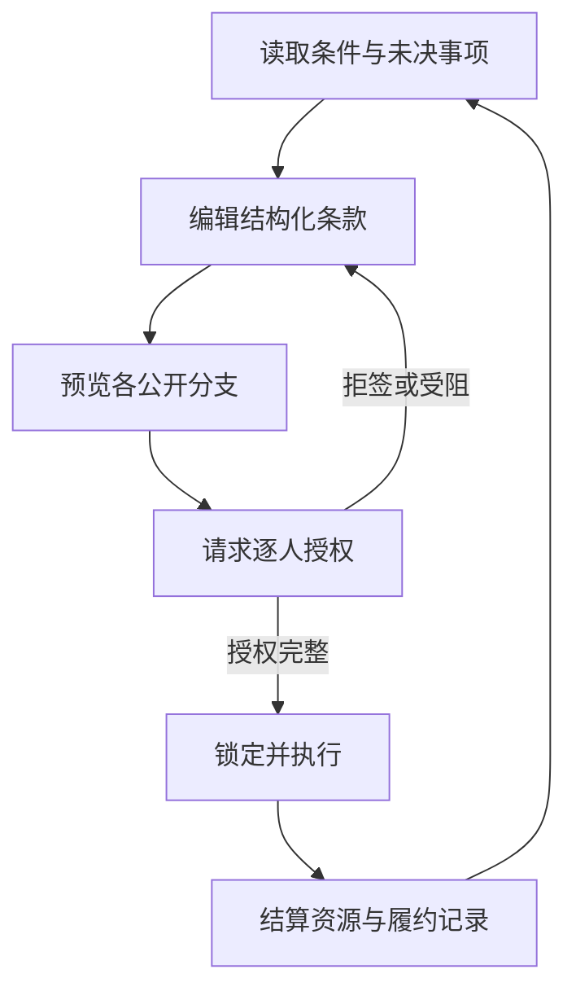

# 《共同署名》Game Design Document

版本：1.0-draft｜2026-10-01｜用途：开发基线、内容约束与验收依据

> 本文把阶段1—5整理为一个可开发方案，并对冲突作出裁定。凡与早期候选方案冲突，以本文为准；尚未经过真人测试的设计仍标为“待验证”，不因写入GDD而视为成立。

## 0. 已裁定的跨阶段矛盾

| 问题 | 早期文档中的张力 | 本GDD裁定 |
|---|---|---|
| 章节与结算轮数 | 五章叙事，但核心模型只有三轮 | 五章、三个生产周期。第一、三、四章各结算一次；第二、五章只读状态，不扣生活支出、不减少轮次 |
| 角色数量 | 五名主要人物，经济模型只有三人 | 五人均为主要角色；仅约纳斯、玛塔、埃米尔进入生产数值。伊达、安东进入叙事、知识与授权数据，不拥有伪造的工时条 |
| 视觉方向 | 阶段5保留A/B/C三套候选 | MVP采用A“校样与边注”为唯一生产基线。B“共同节拍”和C“各自的窗口”只做同数据研究样张，不进入首版主流程 |
| 游戏时长 | 原型20—25分钟；正式短篇60—90分钟 | 首版可玩Demo为20—25分钟；MVP为60—90分钟五章短篇；正式版目标90—120分钟，不靠重复结算拉长 |
| 动态价格 | 阶段5包含价格变化表现，阶段3明确固定价格 | Demo与MVP单价固定为1。保留`priceFeatureEnabled=false`接口，但不开启、不写相关剧情 |
| 历史场景 | 虚构德语区城市，但制度尚未校核 | 原型可继续使用“1848年秋、虚构德语区河港城市”；进入正式内容锁定前必须选定制度参照地区并完成史料审查 |
| 《宣言》的身份 | 主题来源容易被误当作游戏规则证明 | 原文、角色解释、学术解释、后世接受、游戏原创始终分层。生产《宣言》相关材料不等于赞同内容 |
| 签名的含义 | 生产签名可能被叙事误用为共同立场 | 生产协议、交付收据、个人陈述许可、共同说明署名是四个独立授权域，任何一个都不能替代另一个 |
| 查询后的签名 | 查询会揭示真值，也消耗约纳斯时间 | Demo只允许在当前版本请求签署前查询。已有签名时需先“返回草案”生成后继版本；不允许在签后用查询改变可行性 |
| 提前完成 | 三轮任务与五章固定结构可能冲突 | 当前数值下最早只能在第三轮完成。通用规则仍定义：若`Q=0`，后续生产周期跳过，不再扣生产期生活支出，但叙事收束与公共说明仍进行 |
| 失败命名 | 拒签、暂停、未履约容易被统一叫失败 | 四者为不同状态，分别保存原因；合法拒签和按约暂停不会写入违约 |

## 1. 项目概览

**项目名：**《共同署名》  
**类型：** 单人、文字驱动、回合制协议编辑与社会关系模拟  
**题材：** 1848年历史启发的虚构印刷作坊；《共产党宣言》的生产、阅读与代表性争论  
**表现：** 2D语义化界面、无自由漫游、无传统战斗、默认无人物立绘  
**商业与发行假设：** 独立短篇；先以免费或展会Demo验证，再决定完整发行模式  
**开发状态：** 设计整合完成；核心玩法、可读性与历史细节均待验证

### 一句话定位

玩家以有限权限起草一份劳动协议，通过修改工作、报酬和风险条款取得逐人授权；协议执行后，真实结果返回页面，迫使玩家面对“共同完成一项工作”与“共同代表一种立场”之间的距离。

### 设计支柱

1. **文字是可执行关系。** 条款不是对白选项，而是直接计算时间、付款、产出和权限的结构化对象。
2. **同意有范围。** 人物同意劳动，不等于同意被代表；拒签必须有公开、可理解的条件。
3. **后果可追溯。** 每项资源变化都能回到版本、条款、外部条件和执行记录。
4. **不存在总幸福分。** 资金、交付、收入、个人时间、生活缺口与持续合作分别呈现。
5. **历史材料有身份。** 游戏原创模型不冒充史实，角色解释不冒充原文。

## 2. 设计目标与非目标

### 2.1 设计目标

- 让玩家在没有长篇理论讲授的情况下理解：形式相同的安排可能造成不同的实际负担。
- 让玩家至少比较两种均有合理理由、但保护不同目标的方案。
- 让拒绝、退出、局部合作和未完成任务成为可玩的结果，而非系统故障。
- 让“预付能力”和“最终收支”成为两个可区分的问题。
- 让排版直接显示主体、范围、版本和授权变化，同时保持稳定阅读模式。
- 让玩家在结算后能回答“是哪一条约定造成了这个结果”。
- 让《宣言》成为带来源的政治文本和争论对象，而不是自动给出正确选项的提示书。

### 2.2 非目标

- 不模拟完整的1848年城市经济、阶级结构或革命进程。
- 不证明某种经济制度、政治路线或组织形式必然优越。
- 不把经营利润最大化当作主要胜负条件。
- 不提供自由自然语言合同、生成式人物对话或AI立场评分。
- 不制作开放世界、角色移动、战斗、养成、技术树或全产业链。
- 不以读完《共产党宣言》、答对理论题或选择统一口号作为通关条件。
- 不用隐藏信任、忠诚或“觉悟”数值决定签名。

## 3. 目标玩家与目标体验

### 3.1 目标玩家

- 喜欢文字游戏、制度叙事、互动非虚构、桌面式资源权衡的玩家。
- 对政治思想、劳动史、书籍史或实验排版有兴趣，但不要求读过《宣言》。
- 能接受低动作强度、以阅读和比较为主的单人体验。
- 主要测试对象为中文读者，建议首轮年龄分级按12+或当地相近等级评估；正式评级另行送审。

### 3.2 目标体验

玩家应依次经历：

1. “我以为把数字分平均就够了。”
2. “同一份草案在不同人的生活里不是同一回事。”
3. “我可以写得更清楚，但不能写出不存在的钱和时间。”
4. “协议执行的是此前获准的分支，不会在结果后替我改口。”
5. “完成工作、愿意再次合作、同意共同发言是三件不同的事。”

体验不应变成：寻找所有签名变绿的唯一解、反复点击刷人物同意、用红色和警报判断政治立场、读长对白后选态度按钮。

### 3.3 时长与重玩

| 版本 | 首轮时长 | 重玩价值 |
|---|---:|---|
| 可玩Demo | 20—25分钟，可放宽至30分钟 | 比较三种风险安排和严重／轻微容量分支 |
| MVP | 60—90分钟 | 比较生产方案、公开署名方式与六类终局 |
| 正式版 | 90—120分钟 | 额外历史材料、条件组合与无障碍完善；不以重复劳动扩时 |

## 4. 核心玩法

### 4.1 玩家身份与权限

玩家扮演约纳斯·韦伯：排字工、校对与临时记录者。他可以起草、比较和提出协议，也必须为自己的劳动签字；他无权替别人同意，无权把专项资金当作个人存款，无权把生产签名扩展为政治署名。

### 4.2 核心循环



一次完整生产周期的固定顺序：

1. 检查版本、参与者、权限、签名和所有已声明分支。
2. 锁定最高可能支付额`Wmax`。
3. 揭示本期未确定外部条件；同一存档不重掷。
4. 按签署条款计算工作、收入或暂停。
5. 支付实际报酬，释放未使用预留。
6. 接收产出，期末回款。
7. 扣生活支出，更新个人储备与生活缺口。
8. 写入不可变履约事件，推进生产期。

### 4.3 玩家每分钟做什么

- 阅读一条具名异议或条件。
- 修改一个人的计划工时、补足金额或风险处理方式。
- 比较计划、公开最坏分支与当前已知结果。
- 决定是否用约纳斯一个时段核实第二轮信息。
- 请求签署并查看精确的接受／拒绝理由。
- 执行有效版本，追踪资金、时间和任务差异。
- 在末章分别处理生产事实、个人陈述与共同说明许可。

### 4.4 控制方式

**主平台：** 鼠标＋键盘。  
**键盘基线：** Tab/Shift+Tab遍历控件；方向键或原生选择控件改值；Enter确认当前控件；Space切换复选；Escape关闭非执行弹层；`[`/`]`仅作为可选版本切换快捷键。  
**原则：** 所有拖拽都有点击和键盘替代；执行、覆盖存档和退出流程必须二次确认；无阅读倒计时。

## 5. 状态变量与资源系统

### 5.1 生产状态

| 变量 | 类型 | 初始／范围 | 更新规则 |
|---|---|---|---|
| `B[actor]`个人生活储备 | integer≥0 | 约纳斯2、玛塔1、埃米尔2 | `max(0,B+w+o-c)` |
| `U[actor]`生活缺口历史 | integer≥0／期 | 0 | `max(0,-(B+w+o-c))`，历史不清除 |
| `T[actor]`本期可用时间 | integer 0..4 | 4、3、4 | 每期加载基准与明确事件 |
| `k[actor]`协调时间 | 0..1 | 0 | 第二期查询令约纳斯`k=1`，同信息不重复收费 |
| `c[actor]`生活支出 | fixed integer | 2、3、2 | 每个实际生产周期扣一次 |
| `F`专项工作资金 | integer≥0 | 9 | `F'=F-Σw+Y` |
| `Q`剩余交付 | integer 0..24 | 24 | `Q'=Q-Y` |
| `d`剩余生产期 | integer 0..3 | 3 | 每次执行或明确无协议后减1 |
| `K`知识状态 | enum＋source | 第二期埃米尔容量为`bounded:[1,3]` | 查询或执行揭示固定真值 |
| `L`履约记录 | append-only events | 空 | 每次结算追加，不覆盖 |

抽象时段不是现实小时。Demo单价与单位产出均固定为1；不存在库存、利息、信贷、税、维修、技能、疲劳或动态物价。

### 5.2 协议决策变量

| 变量 | 范围 | 含义 |
|---|---|---|
| `x[i]` | 0..4 integer | 计划工作时段 |
| `b[i]` | 0..9 integer | 与工时基础报酬分开的固定补足 |
| `g[i]` | `guaranteed` / `actual` | 容量不足时按计划还是按实际工时支付基础报酬 |
| `pauseOnCase` | capacity case或null | 命中指定分支时整期暂停共同协议 |
| `participants` | actor ID set | 劳动或领取补足者必须在列；仅作资源批准者不必在列 |
| `h[i]` | derived | `min(x[i],max(0,T[i]-k[i]))` |
| `w[i]` | derived | 保证：`x[i]+b[i]`；按实际：`h[i]+b[i]` |
| `Y` | derived | `Σh[i]` |
| `Wmax` | derived | `Σ(x[i]+b[i])`，必须`≤F` |
| `f[i]` | derived | 参与者：`T-k-h`；独立活动者：0 |

`x=0,b>0`允许，但领取者仍是本期参与者、必须签字且不能领取独立活动收入。它表达有条件的收入保障，不提供隐形产出。

### 5.3 独立活动与局部合作

- 未参加共同协议者取得本期独立收入`o=1`，并占用其扣除协调后的全部剩余时间；若可用时间为0，则`o=0`。
- 参与共同协议者不能同时取得独立收入。
- 未参加者不必批准其他人的合法合作，也不能被分配工作、补足或风险。
- 若整期按约暂停，所有生产参与候选人转为独立活动，`F`与`Q`不变，生活收支照常结算，`d-1`。

### 5.4 不变量

- `F≥0`、`Q≥0`、所有个人储备`B≥0`。
- 回款只在支付之后进入`F`，不能支付本期工资。
- 共同资金守恒：`F'+Σw=F+Y`。
- 已处理的执行命令具有唯一`transactionId`；重复点击、页面恢复或网络重试不得重复结算。
- 外部真值在新游戏创建时固定并随存档保存；预览、回看、读档不重掷。
- 历史记录只追加；语义新版本不能重写旧记录。

## 6. 协议、授权与选择系统

### 6.1 四类条款

1. **工作分配：** 主体、计划时段、期次。
2. **报酬分配：** 基础报酬、固定补足。
3. **变化处理：** 保证／按实际支付，或指定分支暂停。
4. **生效与复议：** 有效期、参与者、必要授权、重新讨论条件。

条款全部由有限字段生成自然语言；程序不解析玩家输入的合同句子。

### 6.2 四个授权域

| 域 | 作用 | 必须签署者 |
|---|---|---|
| `production`生产协议 | 工作、收入、风险与设备使用 | 所有参与者＋埃米尔的资金／设备许可＋约纳斯执行确认 |
| `receipt`交付收据 | 数量、时间、款项事实 | 交付方与安东的验收确认 |
| `statement`个人陈述 | 一段个人话语的公开范围 | 该陈述本人 |
| `jointStatement`共同说明 | 这一版共同表述 | 被列为共同署名的每个人 |

生产许可绝不自动复制到后三个域。拒绝公共说明不能取消已付报酬。

### 6.3 版本规则

- 草案可无限编辑，不推进游戏时间。
- 修改主体、工时、金额、风险、期限或参与集合，创建新的`semanticRevision`，当前生产签名全部失效。
- 纯布局、字号、主题、折叠和阅读顺序偏好不创建语义版本。
- “请求签署”是确定性检查，不含随机说服。
- 每个签名绑定`versionId + domain + actorId`。
- 查询只可在该轮尚无签名时执行。若已有签名，玩家须“返回草案”，生成后继版本后再查询和签署。

### 6.4 接受条件

Demo中，参与者只检查公开规则：

- 每个获准执行分支中，计划工作不违反已知时间规则；未知容量必须有合法处理分支。
- 该分支结算后个人储备至少为1。
- 专项资金最高锁定额不超过当前`F`。
- 未参与者没有被写入工作或补足。
- 所需资金、设备与劳动权限齐全。

拒签返回结构化原因，如`reserve_below_minimum`、`missing_risk_branch`、`funds_exceeded`，并定位字段；反复请求相同版本得到相同结果。

## 7. 事件系统

### 7.1 事件类型

- `worldCondition`：外部条件，如第二期埃米尔容量。
- `knowledgeReveal`：查询或执行揭示真值。
- `narrativeRequest`：伊达提出时间边界、安东请求共同说明。
- `authorization`：签署、拒签、撤回、过期。
- `settlement`：锁定、支付、产出、回款、生活支出。
- `chapterTransition`：只切换叙事，不一定推进经济期。

### 7.2 调度规则

- 每个事件有稳定ID、最早章节、触发条件、可见条件、一次性标记和后续效果。
- 事件只读规则状态后生成内容；叙事文本不得直接修改`F/B/Q/T`。
- 同一事件在已消费后不得重复执行；回看只显示快照。
- 条件片段必须有安全回退文本，避免状态组合导致空白或事实矛盾。

### 7.3 固定事件

| ID | 时点 | 作用 |
|---|---|---|
| `E1_AVERAGE_REFUSAL` | 第一章首稿 | 若玩家提交2/2/2且各付2，玛塔因期末储备0拒签；若玩家已解决则显示可接受原因，不强制拒绝 |
| `E2_EMIL_CAPACITY` | 第二生产期 | 真值为1或3；开局公开范围，查询或执行揭示 |
| `E3_JOINT_STATEMENT` | 第四章 | 安东请求共同说明；玩家只能决定约纳斯的回应与文档结构，其他人按公开条件回应 |

## 8. 叙事、章节与故事概要

### 8.1 故事概要

1848年秋，一座虚构的德语区河港城市。临河印刷作坊承接一批阅读资料，其中包含《共产党宣言》相关材料与不同意见。约纳斯负责整理生产协议。第一天的分工让同样的金额进入不同生活；第二天，埃米尔事先披露的时间风险真正发生；第三天，委托联络人安东希望用“我们”介绍这次合作。玩家最终需要分别确认：工作完成了多少、每个人承担了什么，以及谁愿意让自己的名字出现在怎样的共同表述下。

### 8.2 章节结构

| 章 | 生产期 | 玩家核心行为 | 结尾携带状态 |
|---|---:|---|---|
| 一《空着的姓名栏》 | 1 | 学习条款、处理第一份安排与授权 | 首轮`B/F/Q/U/L` |
| 二《到账之后》 | 无 | 对照账目与生活，记录伊达的边界 | 只增加知识与待讨论项 |
| 三《缺席的时段》 | 2 | 查询、保守安排或条件承诺 | 外部真值、第二轮结算 |
| 四《还差多少》 | 3 | 最后生产安排；生产签名与公共署名分离 | 最终交付、个人结果、表述许可 |
| 五《各自保留一份》 | 无 | 核对副本、决定后续讨论意向 | 终局＋人物后记轴 |

## 9. 人物与关系

| 人物 | 职业与权力 | 核心欲望 | 核心矛盾 | 系统角色 |
|---|---|---|---|---|
| 约纳斯·韦伯 | 排字、校对、记录；能提案，不能批资金 | 写自己的小册，保留独立时间 | 反对被代言，却会替别人“整理” | 玩家角色／生产甲 |
| 玛塔·克莱因 | 折页装订；只授权自己的劳动与陈述 | 稳定现金与不必反复请求的自由时间 | 支持保障，也可能把压力转给妹妹 | 生产乙 |
| 埃米尔·霍夫曼 | 印工、设备与专项资金批准 | 保住作坊与亲手工作的生活 | 要求共同负责，却难放下批准权 | 生产丙／资源授权者 |
| 伊达·克莱因 | 缝补工，有独立订单 | 让自己的时间不再默认给家庭让路 | 真心互助，也怨恨互助被视为义务 | 家庭时间与陈述边界 |
| 安东·罗特 | 抄写员、订印与阅读小组联络 | 形成持续公共讨论 | 重视共同声音，却会压缩分歧 | 委托、验收与共同说明请求 |

关系不是好感线。师徒不等于服从，家庭不等于无限照护，委托不等于思想授权。

## 10. 终局

先按交付判定：`complete(Q=0)`、`partial(0<Q<24)`、`none(Q=24)`；再按甲乙丙愿意继续讨论的集合`C`判定。公共表述形式另行组合，不影响生产终局。

| ID | 条件 | 名称 |
|---|---|---|
| E1 | Q=0且C为三人 | 《下一稿仍在桌上》 |
| E2 | 部分交付且C为三人 | 《留下一页》 |
| E3 | 有交付且C为两人 | 《两份地址》 |
| E4 | Q=0且C至多一人 | 《结清之后》 |
| E5 | 部分交付且C至多一人 | 《到这里为止》 |
| E6 | Q=24 | 《没有共同出品》 |

表述结果为：共同署名并保留异议／个人署名并列／只报告获准事实。没有“真结局”，也不以完成交付抹掉个人缺口。

## 11. UI与视觉设计

### 11.1 MVP视觉基线：校样与边注

页面像一份正在形成的校样：中央协议正文、左侧人物条件、右侧具名边注。执行后的版本成为不可擦除记录，新版通过差异与编号继承，而非覆盖历史。

宽屏12列：条件2列／正文7列／旁注3列；最大内容宽1280px、外边距40px、沟槽24px。中屏条件摘要置顶，正文8列／旁注4列；窄屏按人物条件→条款→相关批注→后果单列。正文随内容增高，不锁定视口高度。

### 11.2 核心组件

- 章节／期次头、版本标识、材料身份标签。
- 三人条件卡、权限与知识状态。
- 四类条款块与语义编辑控件。
- 版本差异、四类授权域、签署单元。
- 阻止原因、后果预览、资金锁定摘要。
- 具名请求／批注、履约记录侧栏。
- 执行确认、设置、终局副本。

### 11.3 信息层级

1. 当前动作与阻止原因。
2. 当前条款、适用者和版本。
3. 时间、储备、资金与交付后果。
4. 来源、履约与版本记录。
5. 环境纹理、余韵与非必要装饰。

### 11.4 色彩

浅色默认：纸面`#F4F0E6`、墨色`#242824`、辅助`#596057`、操作强调`#275D62`、待处理`#78531E`。颜色从不单独传达状态；签署、拒绝、受阻、过期均附文字与线型。不同意不使用危险红，共同署名不使用胜利绿。

## 12. 字体、动画与声音

### 12.1 字体规则

- 正文／章节：思源宋体SC；控件／状态：思源黑体SC；正式打包固定版本与授权文件。
- 章节标题32/44px 600；协议标题24/34px 600；条款18/32px 400；批注16/28px；元信息14/22px。
- 实装使用`rem`，正文默认不低于18px目标；每行约24—34个汉字。
- 数值启用等宽数字特性；姓名、金额、否定词和条件词不得拆成孤立动画字符。
- 不使用`word-break: break-all`；翻译后重新测试换行，不按中文版像素硬定位。

### 12.2 动画规则

- 选择反馈100—120ms；批注展开180ms；语义块确认移动≤240ms；结算说明≤400ms。
- 动画只解释已提交的状态变化，不参与计算；可跳过、失焦或低动态时结果完全一致。
- 不使用震屏、闪烁、汉字碎裂、持续重影或数值滚过不存在的中间值。
- `prefers-reduced-motion`默认生效，并提供完整／减少／无动画三档。

### 12.3 声音规则

- 三路：操作、信息事件、环境；默认不自动播放，用户主动开启。
- 纸面触点、排字触点、低强度材料与机械环境声；确认和拒签响度相近。
- 无胜利和弦、失败警报、逐字打字声、政治立场主题音。
- 总静音与单声道可用；声音不承载独有信息。

## 13. 存档系统

### 13.1 存档槽

- 1个自动存档、3个手动槽；Demo仅需自动存档＋“重新开始”。
- 自动存档点：新游戏创建后、查询后、签署结果后、每次结算事务完成后、章节结束、最终许可确认后。
- 不在结算事务中间写可恢复存档；先计算新状态和事件，再原子提交快照。

### 13.2 保存内容

保存`schemaVersion`、游戏版本、内容版本、当前章节／期次、规则状态、外部事件真值、所有语义版本、授权、履约事件、叙事标记、玩家设置。声音／阅读偏好与游戏进度分区保存。

### 13.3 兼容与安全

- MVP使用IndexedDB；提供导出／导入JSON作为调试和迁移工具。
- 加载时先校验结构与校验和，再执行版本迁移；迁移失败保留原存档并提示，不静默覆盖。
- 存档不含任意可执行代码；文本内容只引用已打包ID。
- 回看旧版本是只读行为，不能再次触发结算。

## 14. 数据结构

规则层采用可序列化对象和纯函数，不让DOM成为真相来源。

```ts
type ActorId = 'jonas' | 'marta' | 'emil' | 'ida' | 'anton';
type ProducerId = 'jonas' | 'marta' | 'emil';
type ApprovalDomain = 'production' | 'receipt' | 'statement' | 'jointStatement';
type SignatureState = 'pending' | 'accepted' | 'refused' | 'invalidated' | 'expired';
type RiskMode = 'guaranteed' | 'actual';

interface GameState {
  schemaVersion: number;
  sessionId: string;
  chapterId: string;
  period: 1 | 2 | 3;
  periodsRemaining: number;
  fund: number;
  remainingDelivery: number;
  producers: Record<ProducerId, ProducerState>;
  knowledge: Record<string, KnowledgeState>;
  worldFacts: Record<string, number | string | boolean>;
  currentDraft: AgreementVersion;
  agreements: AgreementVersion[];
  signatures: Signature[];
  ledger: LedgerEvent[];
  narrativeFlags: Record<string, boolean | string | number>;
  processedTransactionIds: string[];
}

interface AgreementVersion {
  id: string;
  parentId: string | null;
  semanticRevision: number;
  period: number;
  participants: ProducerId[];
  clauses: Clause[];
  createdAtSequence: number;
  status: 'draft' | 'signed' | 'settled' | 'superseded';
}
```

`LedgerEvent`至少包含`eventId, transactionId, sequence, period, type, actorId?, clauseId?, before, delta, after, reasonCode`。所有结果页面从规则快照与账本渲染，不从叙事字符串反推数字。

## 15. 文本数据结构

文本不直接写死在组件内。每个条目具有身份、说话者、授权域、条件与变量插槽。

```json
{
  "id": "ch3.emil.capacity.revealed.low",
  "kind": "narrative",
  "speakerId": "emil",
  "sourceKind": "fiction",
  "approvalDomain": null,
  "when": ["chapter=ch3", "world.emilCapacity=1"],
  "body": "回执确认：埃米尔本期只有{capacity}个可工作时段。",
  "variables": {"capacity": "integer"},
  "tags": ["capacity", "knowledge-reveal"],
  "notesForTranslator": "‘时段’为抽象单位，不译成具体小时。"
}
```

历史材料另含`author, originalDate, region, edition, translator, section, sourceUrl, verificationStatus, permittedClaim, prohibitedInference`。未核定条目不能使用`quotation`身份发布。

## 16. 本地化

- 文本ID稳定，句子使用具名插槽，不拼接会破坏语序的半句。
- 数量、姓名、日期和货币格式走locale格式化；抽象“资金单位”不伪装成真实货币。
- UI预留简体中文150%、德语180%、英语130%的长度膨胀测试。
- 字体按语言配置回退与字形；不要用字符宽度决定规则范围。
- 原文、译文、角色概述分别存储；每个译本保留译者和版本。
- 伪本地化、长词、CJK禁则、RTL可行性在MVP后评估；正式版至少完成中文与一种外语的结构验证，再承诺语言列表。

## 17. 无障碍

- 语义HTML优先；按钮、表单、表格、标题和状态区域使用原生元素。
- 完整键盘操作，焦点顺序与视觉顺序一致；焦点样式不低于3:1。
- 普通文字对比≥4.5:1；颜色不是唯一状态标记。
- 支持200%缩放与约320 CSS像素宽重排；不出现双向滚动才能阅读主流程。
- 提供低动态／无动画、高对比、字号、行距、静音、单声道设置。
- 执行结果用`aria-live="polite"`摘要，拒签原因在触发控件附近并可读屏定位；不抢正在编辑的焦点。
- 无限时阅读、无快速反应要求、无只靠拖拽的操作。
- 自动化无障碍扫描只能发现部分问题；每个里程碑进行键盘、读屏、缩放和低动态人工检查。

## 18. 技术方案

### 18.1 目标平台

MVP目标为桌面现代浏览器：Windows与macOS上的Chrome/Edge/Firefox，Safari作为兼容验证目标。触屏可浏览但Demo不承诺完整手机体验。后续如需Steam，可用轻量桌面封装评估，不在首版引入。

### 18.2 建议引擎与栈

**建议“引擎”：浏览器原生UI，而非Godot。** 使用TypeScript strict、语义HTML、CSS Grid和Vite构建；不使用Canvas承载核心文字。原因是本项目依赖可重排文本、表单、键盘和读屏语义，Web平台比游戏画布更直接。[Vite官方指南](https://vite.dev/guide/)提供TypeScript开发与生产构建入口；版本在项目启动时精确锁定。

测试使用Vitest或同级单元测试器验证纯规则函数，[Playwright](https://playwright.dev/docs/browsers)覆盖Chromium、Firefox、WebKit关键路径；无障碍自动检查参考其[`@axe-core/playwright`指南](https://playwright.dev/docs/accessibility-testing)，并保留人工测试。

[IndexedDB](https://developer.mozilla.org/en-US/docs/Web/API/IndexedDB_API)用于本地持久化结构化存档；它可保存结构化克隆支持的对象，适合版本化快照与事件记录。

### 18.3 分层

- `domain/`：纯规则、验证、预测、结算、终局判定。
- `content/`：人物、章节、历史材料、文本条件。
- `application/`：命令、事务、存档、迁移。
- `ui/`：组件、页面、可访问性状态、动画适配器。
- `audio/`：事件到声音映射，不修改规则。

## 19. 项目目录结构

```text
common-signature/
├─ docs/
│  ├─ gdd/
│  ├─ research/
│  └─ playtests/
├─ public/
│  ├─ fonts/
│  ├─ audio/
│  └─ sources/
├─ src/
│  ├─ domain/
│  │  ├─ model.ts
│  │  ├─ agreement.ts
│  │  ├─ forecast.ts
│  │  ├─ settlement.ts
│  │  ├─ endings.ts
│  │  └─ invariants.ts
│  ├─ application/
│  │  ├─ commands.ts
│  │  ├─ transaction.ts
│  │  ├─ saveRepository.ts
│  │  └─ migrations/
│  ├─ content/
│  │  ├─ actors.json
│  │  ├─ chapters.json
│  │  ├─ events.json
│  │  ├─ text.zh-CN.json
│  │  └─ sources.json
│  ├─ ui/
│  │  ├─ components/
│  │  ├─ screens/
│  │  ├─ styles/
│  │  └─ accessibility/
│  ├─ audio/
│  └─ main.ts
├─ tests/
│  ├─ unit/
│  ├─ property/
│  ├─ fixtures/
│  └─ e2e/
└─ package.json
```

## 20. 内容制作流程

1. **研究登记：** 为材料建立证据身份、地区、日期、版本、可支持与不可支持的判断。
2. **规则先行：** 内容作者先写触发条件和状态变化，再写人物反应；叙事不能直接改资源。
3. **人物边界检查：** 每段反馈核对人物已知／未知、权限和公开意愿。
4. **结构化录入：** 使用文本ID、条件、插槽、来源和授权域，不把逻辑藏在散文里。
5. **自动校验：** 检查缺ID、死分支、无来源引文、未替换插槽、状态矛盾。
6. **规则回放：** 用固定种子跑所有关键路径，核对账本和文案事实。
7. **编辑与史审：** 文学编辑、历史顾问、敏感性审读分别签核，不互相替代。
8. **本地化与布局QA：** 伪本地化、放大、窄屏、键盘、读屏和低动态验证。

## 21. 范围与优先级

### Must Have

- 三人、三生产期、一项容量事件、四类条款。
- 确定性预览、签署、资金锁定、结算、独立活动与履约记录。
- 语义版本与签名失效；四种授权域的数据边界。
- “校样与边注”主界面及稳定阅读方式。
- 自动存档、重复执行保护、固定事件种子。
- 键盘、低动态、缩放、颜色非唯一信息。
- 至少覆盖第一轮拒签、第二轮三种风险方案、第三轮继承后果。

### Should Have

- 五章完整叙事、五名人物、六类终局。
- 公共说明与个人陈述授权。
- 版本差异、因果回溯、导出调试存档。
- 可选《宣言》材料卡与明确来源身份。
- 三浏览器E2E、axe自动检查和人工无障碍清单。

### Could Have

- B/C视觉系统的独立研究样张。
- 第二组固定外部条件或不同权限配置的实验模式。
- 开发者回放器、路径覆盖可视化、匿名本地测试日志导出。
- 章节间少量工作物特写与扩充环境声。

### 明确不做

- 自由输入合同、LLM人物、隐藏好感／忠诚／觉悟值。
- 战斗、探索地图、角色移动、立绘收集、恋爱攻略。
- 动态物价、债务、疲劳、技能树、设备升级、库存、完整市场。
- 多人在线、云存档、排行榜、成就驱动的政治评分。
- 强制逐字动画、限时选择、只靠颜色或声音表达状态。
- 真实人物替换原创角色，或把原创协议冒充历史制度。

## 22. 原型、MVP与正式版

| 层级 | 内容 | 验收门槛 |
|---|---|---|
| 原型 | 20—25分钟无对白规则切片，功能身份，严重容量分支 | 玩家能解释两条因果、一次拒签和上一轮造成的资金限制；规则不变量全通过 |
| MVP | 五章、五人、三个结算周期、六终局、A视觉与基础音频 | 完整首轮60—90分钟；所有终局可达；无状态矛盾；键盘与缩放主流程可完成 |
| 正式版 | 内容精修、史料校定、至少一种外语结构验证、完整QA | 史料与引文签核、浏览器矩阵、无障碍人工测试、公开测试反馈闭环 |

## 23. 风险

### 23.1 开发风险

| 风险 | 影响 | 缓解 |
|---|---|---|
| 条件组合爆炸 | 文案遗漏、状态冲突 | 固定章节＋状态片段；建立路径枚举与回放器 |
| 规则与UI双重计算 | 预览和实际不一致 | 预览与结算共享同一纯计算器；UI只读结果 |
| 重复结算／存档中断 | 资源被重复扣加 | 事务ID、原子提交、处理ID集合、故障注入测试 |
| 中文排版与缩放溢出 | 核心文本不可读 | 语义DOM、响应式网格、伪本地化与320px检查 |
| 音画效果阻碍访问 | 玩家无法完成主流程 | 动画适配层、低动态、静音、无唯一音频信息 |

### 23.2 设计风险

| 风险 | 识别信号 | 处理 |
|---|---|---|
| 找绿灯而非理解关系 | 玩家不能解释拒签，只不断调数 | 隐去总可接受指示，突出逐人原因和取舍 |
| 存在支配策略 | 所有状态同一方案明显更好 | 穷举Demo空间，调整初始条件或明确不同目标，不用随机惩罚 |
| 文档编辑器感过强 | 玩家只填表、没有期待结算 | 缩短编辑路径，加强计划／实际差异和版本回流 |
| 人物成为生产槽位 | 玩家只称“甲乙丙” | MVP加入职业、愿望、具名反应，但不新增隐藏心情规则 |
| 开放结局变成无判断 | 所有结果被写成“都一样” | 对可核查损失明确陈述；开放的是价值排序与未来解释 |

### 23.3 历史与文本准确性风险

- 不能把虚构城市当作无须研究的许可；正式版需选地区并核查出版制度、职业可行性、性别与财产权、工资物价、印刷流程。
- 不把英国工厂法推广为整个德语区制度。
- 不把1848年革命写成由《宣言》单独引发。
- 不让1848年人物知道1872年序言或20世纪接受史。
- 正式引文前确定中文底本、译者、版次与德文对应；工作性概述不得加引号冒充原文。
- 家庭照护与授权程序是现代设计拓展，应明确为创作模型。
- 所有历史材料需保留“可支持／不可支持”字段，避免一份材料被重复当作多个独立证据。

## 24. 测试与通过标准

Demo首轮招募5—8名未读过《宣言》的中文玩家，用统一说明。定性继续条件：

- 多数玩家无需主持人解释，能区分草案、签署与执行。
- 能指出至少一项修改影响了谁的时间、收入或共同资金。
- 能把第三期限制追溯到第二期条款与实际容量。
- 能解释玛塔拒签的公开原因，而非认为人物随机刁难。
- 能提出另一种合理安排及其代价。
- 愿意在结果后修订，而不只寻找“作者正确答案”。

若这些不成立，先改规则、反馈和信息架构，不用长对白补洞。

## 25. 开发决策摘要

首个实现目标不是完整游戏，而是一个确定性、可回放、键盘可完成的三期规则切片。只有当它证明“编辑—授权—执行—追责”本身值得玩，才进入五章文本、美术精修和正式史料引文。独立的程序实现规格见《阶段6_第一版可玩Demo开发规格.md》。
