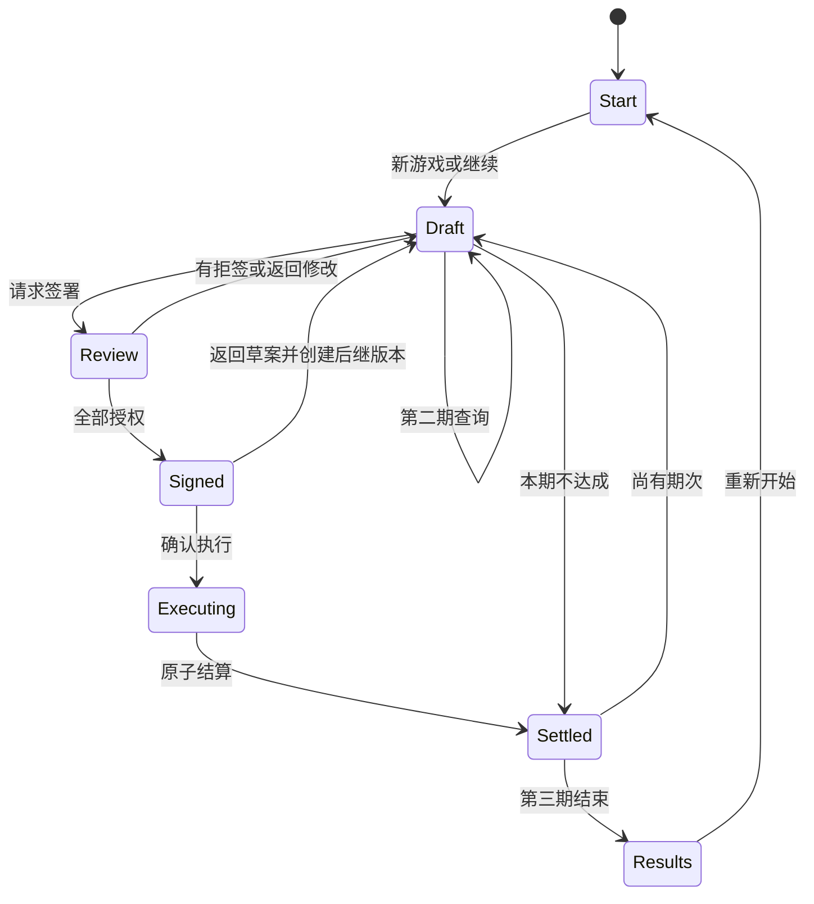

# 《共同署名》第一版可玩 Demo 开发规格

版本：1.0-draft｜2026-10-01｜目标：可直接交给程序员或Codex实现

## 1. 交付定义

实现一个本地可运行、可构建的桌面浏览器Demo。玩家在20—25分钟内完成三次生产期：编辑协议、预览公开分支、请求签署、执行结算，并从第三期状态追溯前一轮条款造成的后果。

本Demo验证核心规则，不实现五章完整叙事、五人角色弧线、共同说明署名或正式历史引文。界面采用“校样与边注”基线；角色显示约纳斯、玛塔、埃米尔姓名与功能性短说明，不用甲乙丙作为最终可见称呼。

### 1.1 完成定义

满足以下全部条件才算交付：

- `npm install`、`npm run dev`、`npm run build`、`npm test`可执行。
- 新游戏到结果页可仅用键盘完成。
- 三期数值、签署和独立活动按本规格计算。
- 第二期外部容量在开局固定，读档与预览不改变。
- 重复点击执行、刷新页面或恢复自动存档不会重复结算。
- 关键规则单元测试和三条端到端路径通过。
- 1440、1024、768与约320 CSS像素宽布局无主流程信息丢失。
- 低动态模式不播放位移动画，但显示等价差异信息。

## 2. 明确范围

### 2.1 包含

- 新游戏、继续、重新开始。
- 一张主界面：条件区、协议区、预测／实际区、折叠记录侧栏。
- 三位生产者、一项任务、三期、第二期一个离散容量事件。
- 工作、补足、风险、暂停、参与范围、版本与签署。
- 局部合作、无协议、整期暂停、独立活动。
- 计划／公开分支／实际对照。
- 自动存档、设置、结果复盘。
- 开发模式的固定容量选择与状态导出；生产构建隐藏开发入口。

### 2.2 不包含

- 伊达、安东、五章叙事、公共说明、六主终局。
- 历史原文卡、正式引文、角色对白或立绘。
- 音频资产；只保留声音事件接口和静音设置占位。
- 手动存档槽、云存档、账号、埋点上传。
- 动态价格、疲劳、技能、债务、设备维护、库存、自由文本。
- B/C两套视觉系统。

## 3. 技术基线

- TypeScript strict。
- Vite构建；使用项目创建时的稳定版并锁定lockfile，不在规格中依赖浮动版本。
- 原生语义HTML＋CSS Grid＋模块化TypeScript；首版不引入大型UI框架。
- 规则层无DOM依赖，使用纯函数与不可变输入输出。
- IndexedDB保存自动存档；若初始化失败，退化为内存会话并显示“本次无法保存”，不能假装已保存。
- 单元测试覆盖规则与不变量；Playwright覆盖浏览器主流程。

## 4. 页面与流程

### 4.1 页面

1. **启动页**：新游戏／继续／设置。
2. **主协议页**：三栏宽屏，单列窄屏。
3. **执行确认层**：版本、参与者、最高锁定额、可能分支、不可撤销提示。
4. **结算页内状态**：仍在主协议页，协议封存并显示计划／实际差异。
5. **轮次过渡层**：本期摘要与进入下一期。
6. **结果页**：最终资源向量、逐期记录、两个复盘问题、重新开始。

### 4.2 状态机



`Executing`不得成为可持久化的半完成存档状态。应用可以显示动画，但规则事务必须一次完成：旧状态＋命令→新状态＋事件。

## 5. 初始数据

```ts
const DEMO_CONFIG = {
  taskTotal: 24,
  periods: 3,
  initialFund: 9,
  unitRevenue: 1,
  basePayPerWork: 1,
  outsideIncome: 1,
  minReserveAfterParticipation: 1,
  actors: {
    jonas: { reserve: 2, baseCapacity: 4, livingCost: 2 },
    marta: { reserve: 1, baseCapacity: 3, livingCost: 3 },
    emil:  { reserve: 2, baseCapacity: 4, livingCost: 2 }
  },
  periodCapacity: {
    1: { jonas: 4, marta: 3, emil: 4 },
    2: { jonas: 4, marta: 3, emil: [1, 3] },
    3: { jonas: 4, marta: 3, emil: 4 }
  }
} as const;
```

生产默认使用脚本化严重分支`emilCapacity=1`，确保测试能看到保障与实际支付差异。开发菜单可选`1`或`3`；每次“新游戏”生成并保存真值，继续游戏不重置。

### 5.1 初始推荐草案

每期进入草案时，系统可以给出“复制上一期并清除签名”；第一期默认：

```json
{
  "participants": ["jonas", "marta", "emil"],
  "work": {"jonas": 2, "marta": 2, "emil": 2},
  "supplement": {"jonas": 0, "marta": 0, "emil": 0},
  "riskMode": {"jonas": "actual", "marta": "actual", "emil": "actual"},
  "pauseOnEmilCapacity": null
}
```

该草案会使玛塔期末储备为0，因此她拒签。界面不得预先自动替玩家补足。

## 6. 领域模型

```ts
type ProducerId = 'jonas' | 'marta' | 'emil';
type DraftPhase = 'draft' | 'review' | 'signed' | 'settled';
type SignatureState = 'pending' | 'accepted' | 'refused' | 'invalidated';
type KnowledgeKind = 'known' | 'bounded';

interface ProducerState {
  reserve: number;
  livingCost: number;
  baseCapacity: number;
  coordinationUsed: number;
  shortageHistory: number[];
}

interface AgreementInput {
  participants: ProducerId[];
  work: Record<ProducerId, number>;
  supplement: Record<ProducerId, number>;
  riskMode: Record<ProducerId, 'guaranteed' | 'actual'>;
  pauseOnEmilCapacity: 1 | 3 | null;
}

interface AgreementVersion extends AgreementInput {
  id: string;
  parentId: string | null;
  period: 1 | 2 | 3;
  semanticRevision: number;
  phase: DraftPhase;
  signatures: Record<ProducerId, SignatureState> & { funds: SignatureState };
}

interface ForecastCase {
  caseId: string;
  emilCapacity: number;
  paused: boolean;
  actualWork: Record<ProducerId, number>;
  pay: Record<ProducerId, number>;
  outsideIncome: Record<ProducerId, number>;
  freeTime: Record<ProducerId, number>;
  nextReserve: Record<ProducerId, number>;
  shortage: Record<ProducerId, number>;
  output: number;
  nextFund: number;
  nextRemainingDelivery: number;
}
```

所有数值输入解析后必须是安全整数。UI的空字符串是“未完成输入”，不能自动当作0提交。

## 7. 核心函数契约

### 7.1 `validateDraft(state, agreement): ValidationIssue[]`

校验顺序：

1. 每个`work`为0..4整数，每个`supplement`为0..9整数。
2. 非参与者必须`work=0`且`supplement=0`。
3. 参与者中允许`work=0,supplement>0`；仍不可领取独立收入。
4. `sum(work) <= remainingDelivery`。
5. `Wmax=sum(work+supplement) <= fund`。
6. 确定容量下，若`work>capacity`，必须由风险规则产生可计算实际工作；计划工作可高于实际容量，但不得高于字段上限4。
7. 第二期容量未知且埃米尔计划工作大于1时，必须提供风险模式；字段默认已有模式，因此只需防止空值。
8. 至少一名生产参与者，或者玩家必须改用“本期不达成”；全零草案不能伪装成共同协议执行。

`ValidationIssue`包含`code, severity, fieldPath, actorId?, messageId, params`。

### 7.2 `forecast(state, agreement): ForecastCase[]`

- 确定期只返回一个case。
- 第二期未查询时返回容量1与3两个case，按容量升序。
- 第二期已查询时只返回已知真值case。
- 只使用玩家已知的可能集合，不读取真值过滤预览。
- 不修改输入，不产生随机数，不写存档。

### 7.3 `evaluateSignatures(state, agreement, cases): SignatureResult`

对每个参与者检查所有非暂停case：

- `nextReserve[actor] >= 1`；否则该人拒签，理由`reserve_below_minimum`。
- 工作与风险分支可计算；否则理由`unhandled_capacity_case`。
- 非参与者签名显示`not_required`，不显示为“拒绝”。
- 埃米尔的资金许可检查`Wmax<=F`；约纳斯的执行确认与本人劳动签名分开记录，但Demo UI可在同一姓名卡中显示两行。
- 相同版本和状态重复请求返回相同结果，不创建新版本、不推进时间。

签署失败后保持`review`视图；“返回修改”进入`draft`，任何语义编辑创建新版本。

### 7.4 `queryEmilCapacity(state): CommandResult`

前置条件：

- `period===2`。
- 当前版本无`accepted`签名且phase为`draft`。
- 本期尚未查询。
- 约纳斯当前剩余容量至少1。

效果：

- `coordinationUsed.jonas=1`。
- 知识从`bounded:[1,3]`改为`known:<worldFact>`。
- 追加`knowledge_revealed`事件并自动存档。
- 同一信息按钮之后禁用并显示“已核实”；不重复收费。

若已有签名，按钮禁用并提示：“先返回草案；查询会占用约纳斯1个时段，现有版本需重新确认。”

### 7.5 `settleAgreement(state, agreement, transactionId): CommandResult`

前置：phase=`signed`、签署完整、transactionId未处理、验证无错误。

算法：

1. 计算`Wmax`并再次验证`Wmax<=F`。
2. 读取本期固定真值，不重掷。
3. 若命中暂停条件：共同工作与报酬全为0，所有人走独立活动。
4. 否则对参与者计算`h=min(x,max(0,T-k))`；非参与者`h=0`。
5. 参与者收入：保证`x+b`，按实际`h+b`；非参与者共同收入0。
6. 非参与者独立收入：若`T-k>0`则1，否则0；参与者为0。
7. `Y=sum(h)`；`pay=sum(w)`。
8. `nextFund=F-pay+Y`；`nextQ=max(0,Q-Y)`。
9. `rawReserve=B+w+o-c`；`nextB=max(0,rawReserve)`；`U=max(0,-rawReserve)`。
10. 写入一个结算快照与细粒度账本事件，标记transactionId已处理，`d-1`，协议phase=`settled`。

事务完成后才写自动存档。若动画中断，重新打开时直接显示已完成结果。

### 7.6 `settleNoAgreement(state, transactionId)`

所有人按独立活动处理；`F/Q`不变；扣生活支出、记录缺口、`d-1`。事件类型为`no_agreement`，不是`breach`。必须有二次确认：“本期共同任务不会推进，但生活支出仍会结算。”

## 8. 精确数值示例

### 8.1 第一轮拒签

初始草案工作(2,2,2)，补足全0：

- 支付(2,2,2)，产出6，F仍9。
- 期末储备：约纳斯2、玛塔0、埃米尔2。
- 玛塔拒签`reserve_below_minimum`；其他人可接受不代表版本可执行。

玩家可采用以下任一合法修订：

| 名称 | 工作 | 支付 | 产出 | 期末F | 期末储备 | 未安排时间 |
|---|---|---|---:|---:|---|---|
| 基础安排 | 2/3/3 | 2/3/3 | 8 | 9 | 2/1/3 | 2/0/1 |
| 减轻玛塔 | 3/2/3＋玛塔补足1 | 3/3/3 | 8 | 8 | 3/1/3 | 1/1/1 |
| 缩小任务 | 2/2/2＋玛塔补足1 | 2/3/2 | 6 | 8 | 2/1/2 | 2/1/2 |

### 8.2 第二轮严重分支

测试夹具从第一轮基础安排继续：`B=(2,1,3),F=9,Q=16`，埃米尔实际容量1。

| 方案 | 计划工作 | 实际工作 | 实际支付 | Y | 期末F | 期末B | 约纳斯空闲 |
|---|---|---|---|---:|---:|---|---:|
| 保证埃米尔 | 2/3/3 | 2/3/1 | 2/3/3 | 6 | 7 | 2/1/4 | 2 |
| 按实际支付 | 2/3/3 | 2/3/1 | 2/3/1 | 6 | 9 | 2/1/2 | 2 |
| 保守安排 | 4/3/1 | 4/3/1 | 4/3/1 | 8 | 9 | 4/1/2 | 0 |

查询后约纳斯容量由4变3，因此上述保守安排4/3/1将无效；界面必须明确显示“信息已核实，但约纳斯少1个生产时段”。

## 9. UI规格

### 9.1 宽屏布局

```text
[章节/第n期/版本] [记录] [设置]
[人物条件 2列] [协议正文 7列] [批注与预览 3列]
[稳定底部操作区：预览 | 请求签署 | 锁定并执行]
```

窄屏顺序必须是：期次→人物条件摘要→协议字段→签署状态→预测／拒签原因→主操作→记录。底部操作区在放大时不得遮挡内容；可改为文档流内操作区。

### 9.2 人物条件卡

显示：姓名、职业短句、当前储备、生活支出、本期容量、已用协调时间、公开参与底线、权限。第二期未核实时埃米尔显示“1或3”，不能显示连续“1—3”。

### 9.3 条款编辑器

每人一组：参与开关、计划工作步进器、补足步进器、风险选择。参与关闭时，工作与补足归0并禁用；重新开启时不恢复旧值，避免隐形承诺。

风险选择自然语言：

- “容量不足时，仍按计划工作量支付基础报酬。”
- “容量不足时，只按实际工作量支付基础报酬。”

暂停选择：“若埃米尔本期仅有1时段，整期共同安排暂停。”仅第二期显示。

### 9.4 预览

每个case独立卡片，显示：容量条件、是否暂停、三人实际工作／支付／期末储备／空闲、F、Q、生活缺口。预测标签必须写“预览”；执行后标签写“实际”。

不可把两个case平均成期望值，不显示成功概率。

### 9.5 签署反馈

每人显示`同意／拒绝／无需签署／已失效`和一句可定位原因。拒绝不震屏，不用警报红。点击原因聚焦相应字段。

### 9.6 记录侧栏

按期次→版本→事件显示。点击某项资源变化，展示：

- 前值、变化、后值。
- 原因代码的自然语言。
- 来源版本与条款ID。
- 外部容量case。

记录只读。回看执行按钮不存在。

## 10. 视觉与交互令牌

```css
:root {
  --paper: #f4f0e6;
  --ink: #242824;
  --muted: #596057;
  --action: #275d62;
  --pending: #78531e;
  --space-1: 0.25rem;
  --space-2: 0.5rem;
  --space-3: 0.75rem;
  --space-4: 1rem;
  --space-6: 1.5rem;
  --space-8: 2rem;
}
```

- 宋体正文、黑体UI；使用系统字体回退，正式字体文件不属于Demo阻塞项。
- 正文18px/32px目标，控件16px/26px，元信息14px/22px。
- 鼠标点击目标至少32px；触屏样式目标44px。
- 焦点轮廓始终可见；hover不能是唯一反馈。
- 动画：选择120ms、展开180ms、差异240ms、结算≤400ms；减少动态时全部改为即时显示。

## 11. 文本与消息ID

至少实现以下消息代码，不在规则函数内写中文：

| Code | 用途 |
|---|---|
| `reserve_below_minimum` | 某公开分支期末储备低于1 |
| `funds_exceeded` | Wmax超过F |
| `nonparticipant_has_allocation` | 未参与者仍有工作或补足 |
| `delivery_exceeded` | 计划工作总量超过Q |
| `unhandled_capacity_case` | 未知容量没有可执行规则 |
| `signature_required` | 尚缺签署 |
| `signature_invalidated` | 语义修改后旧签名失效 |
| `query_requires_draft` | 查询前需返回草案 |
| `query_already_used` | 同一信息已核实 |
| `transaction_already_processed` | 重复结算被安全忽略 |
| `no_agreement_warning` | 无协议仍会扣生活支出 |

消息模板接收命名参数，如`{actorName}`、`{required}`、`{actual}`，禁止拼接半句。

## 12. 存档规格

### 12.1 自动存档键

数据库：`common-signature-demo`；对象仓：`saves`；键：`autosave`。设置存于`settings`仓。保存对象：

```ts
interface SaveEnvelope {
  schemaVersion: 1;
  appVersion: string;
  savedAt: string;
  checksum: string;
  state: GameState;
}
```

校验和用于发现损坏，不作为安全签名。加载失败时显示错误、允许导出损坏存档和重新开始；不得自动删除。

### 12.2 保存时点

- 新游戏初始化完成。
- 第二期查询完成。
- 请求签署完成。
- 结算事务原子完成。
- 进入下一期和结果页。

编辑每个字段不必立即写IndexedDB；在内存中更新并以300ms防抖保存草案，但执行事务不使用防抖。

## 13. 测试规格

### 13.1 单元测试

至少覆盖：

1. 第一轮2/2/2、支付2/2/2时玛塔拒签。
2. 第一轮三组合法示例精确匹配本规格。
3. 第二轮严重分支三组方案精确匹配本规格。
4. 轻微分支容量3时保证与按实际支付结果相同。
5. 查询只扣约纳斯一次时段，重复查询无变化。
6. 查询不读取新随机值；读档后真值不变。
7. Wmax在回款前校验；`F=7`不能执行最高支付8的方案。
8. 非参与者不工作、不领补足、取得独立收入1。
9. `x=0,b>0`参与者不取得独立收入。
10. 暂停时F/Q不变，三人走独立活动，生活支出照扣。
11. 语义编辑使全部生产签名失效；纯UI设置不失效。
12. 重复transactionId不重复扣款、产出或轮次。
13. 资金守恒属性：每个合法case满足`F'+Σw=F+Y`。
14. 所有合法结算后`F,Q,B,U`非负整数。
15. 预览函数不修改输入，实际结算与对应case一致。

### 13.2 属性／穷举测试

在有限范围枚举每人`x=0..4`、`b=0..2`、两种风险模式、参与集合与容量case。只对通过验证的协议断言不变量；记录是否存在单一方案在所有维度严格支配其他方案，作为调参报告，不直接让测试失败。

### 13.3 端到端路径

- **路径A：基础→保证报酬。** 修正玛塔拒签，第一轮基础安排；第二轮保证埃米尔；第三轮观察F=7限制并完成或部分交付。
- **路径B：查询→保守修订。** 第一轮基础安排；第二轮先查询，看到约纳斯容量损失，重新分配并签署；完成三轮。
- **路径C：局部合作／无协议。** 第一轮让玛塔不参与或明确无协议；验证独立收入、生活支出、Q不被虚假推进及记录命名。

每条路径在Chromium运行；关键布局与键盘路径另在Firefox、WebKit运行。

## 14. 无障碍验收

- 启动到结果页可不使用鼠标。
- 页面标题、主标题、区段标题层级连续。
- 表单标签与输入一一关联；错误使用`aria-describedby`定位。
- 弹层打开后焦点进入，关闭后返回触发器；执行确认不可被背景操作。
- 结算摘要由`aria-live=polite`播报一次，不逐个数字轰炸。
- 200%缩放和320 CSS像素宽下无主流程双向滚动。
- 系统减少动态偏好首次加载即生效；游戏内可覆盖。
- 状态在灰度和色觉模拟下仍能靠文字／形状区分。

## 15. 性能与兼容

- 首屏压缩后JS目标<250KB（不含source map、字体和音频）；超过时记录原因，不为此牺牲语义HTML。
- 常规编辑到预览反馈目标<50ms；结算计算目标<10ms；动画不计入计算。
- 无后端、离线完成主流程；首次加载后不依赖网络。
- 支持最近两个稳定主版本的Chrome/Edge/Firefox，Safari以当前稳定版验证；最终矩阵在实现时锁定并写入README。

## 16. 实施顺序

### 里程碑 M0：骨架（0.5—1天）

- Vite＋TypeScript strict、目录、格式化、测试、基础HTML。
- 完成标准：构建、测试与空页面E2E通过。

### M1：纯规则层（1—2天）

- 数据模型、验证、预测、签署、查询、结算、不变量与夹具。
- 完成标准：第13.1全部规则测试通过，无UI依赖。

### M2：主流程UI（2—4天）

- 条件卡、协议编辑器、预览、签署、执行确认、结果差异。
- 完成标准：路径A仅键盘可完成。

### M3：存档与记录（1—2天）

- IndexedDB、事务保护、自动存档、履约侧栏、恢复。
- 完成标准：执行后立即刷新不重复结算；损坏存档不被删除。

### M4：响应式与无障碍（1—2天）

- 单列布局、缩放、焦点、低动态、axe与人工清单。
- 完成标准：第14节通过，三浏览器关键路径通过。

### M5：可玩性测试包（0.5—1天）

- 开发容量开关、路径导出、测试说明与反馈问卷。
- 完成标准：测试者可在无主持人补充规则的情况下开始并完成。

估算仅用于排序，不是工期承诺；单人实现需根据现有代码基础调整。

## 17. 程序任务清单

- [ ] 初始化工程与CI脚本。
- [ ] 定义`GameState`、`AgreementVersion`、事件与错误类型。
- [ ] 实现`validateDraft`与字段错误映射。
- [ ] 实现共享`forecast`／`settle`计算器。
- [ ] 实现确定性签署与原因代码。
- [ ] 实现查询命令和固定世界真值。
- [ ] 实现事务ID与结算幂等。
- [ ] 实现自动存档、校验、加载与失败回退。
- [ ] 实现条件卡、编辑器、case预览和签署反馈。
- [ ] 实现记录侧栏与事件溯源。
- [ ] 实现三期推进和结果页。
- [ ] 实现响应式、键盘、焦点和低动态。
- [ ] 补齐规则、属性和E2E测试。
- [ ] 编写README：安装、运行、测试、构建、开发菜单。

## 18. 最终验收场景

验收人员使用默认严重分支：

1. 新游戏看到第一轮2/2/2草案。
2. 请求签署，玛塔明确因期末储备0拒签。
3. 将玛塔工作改为3，形成2/3/3，签署并执行；确认`B=2/1/3,F=9,Q=16`。
4. 第二轮选择2/3/3并保证埃米尔，执行后确认实际工作2/3/1、支付2/3/3、`F=7,Q=10,B=2/1/4`。
5. 第三轮尝试计划总支付8，系统在签署前显示资金不足；玩家缩小或改参与范围后完成结算。
6. 结果页能从`F`变化回到第二轮保证支付条款，并显示未完成交付而不宣布“坏结局”。
7. 返回启动页继续存档，资源不再变化；重复执行命令被安全忽略。

只要上述流程、规则测试和无障碍基线通过，Demo即可进入5—8人定性测试。若玩家仍把它理解为“调数字到全绿”，下一步是修改反馈与选择结构，不是加入更多剧情对白。
